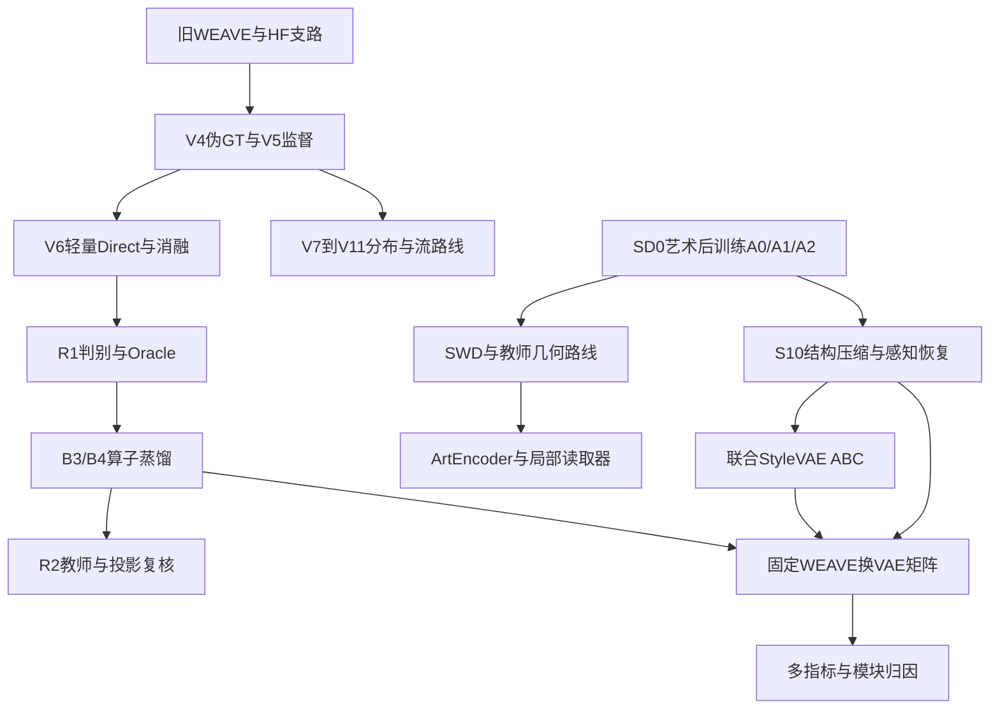

# 研究时间线与转向依据

先后关系以报告内容和产物为准；没有确定日期的阶段不补造日期。WEAVE与VAE是并行线，表的顺序不是声称单卡连续执行。

| 阶段/时间 | 主题 | 实际行动 | 得到的判断 | 索引 |
|---|---|---|---|---|
| 早期复现与支路探索 | WEAVE旧模型 | 论文15epoch重现、逐epoch选择、端点轴；HF增量/空间/子带/记忆/门控等多轮 | 模型可复现；连通和局部正信号未解决稳定目标编辑 | W01–W03 |
| V4，2026-11-06报告 | 伪GT与监督可达性 | 审计D/P5 LL能量、patch strength、reachable比例；S1/S2训练，S3/S4当时未启 | 伪GT强度/低频残留会决定可达性；S1未过独立门槛 | W04–W05 |
| V5阶段 | CSD Oracle与监督端点 | O1/O2/O3上界、B1、源风格保留；Route C RF | 优化margin可由去源风格驱动；更直接监督仍有偏差 | W06–W07 |
| V6主线 | Direct对Flow，结构与目标消融 | D1/F1、ScoreDiff强度；23臂N/L/S、217824参数轻量化 | 单步可用；Style目标必要但目标选择性不足 | W08–W14 |
| V7系列 | Tweedie / DMD / 稳定化 | 去噪器MSE、DMD符号/梯度修正、content稳定化 | 强风格伴内容破坏，稳定版本趋恒等；修正后仍未突破 | W15–W18 |
| V8/V9系列 | CFM、ContentOT、DCAE桥接 | 随机/OT配对、Sinkhorn修正；新表示桥、宽度/OT容量 | 局部两方向有峰值，但不等于D5全任务通过 | W19–W21 |
| V10/V11系列 | 分布矩阵与EDM/随机路径 | 40方案、38实现；6正式代表对照；零梯度/条件统计修正；EDM/SDE/ODE/pivot | 不是40臂都完整执行；修正后也未获稳定全五类改善 | W22–W26 |
| V6 NEXT / R1 | 判别方向与弱监督 | R1真实五类分类、Oracle方向；G0/G1、种子复现、Q2 embedding/trust | 分类器有可用方向；弱ranking/embedding增益有限 | W27–W28 |
| 2026-11-10前后P0/P1 | Oracle与算子蒸馏 | 一步/四步、218K/845K、λ1→20/50 | B3/B4有真增益；分数仍受旧往返链路影响 | W29–W30 |
| VAE基础对照 | Art-A0/A1/A2 | rec+KL、CE、MoCo/SupCon各530updates | 艺术重建改善，不等于几何改善 | V01–V03 |
| 2026-11-08复盘 | SWD失败定位 | 距离/尺度/梯度/ReferenceBank、CSD/ALADIN教师审计 | SWD弱、尺度捷径；CSD更强但未解耦 | V04–V05 |
| 11月8–9日间 | 关系蒸馏与首轮直接风格训练 | REPA计划500仅见220；直接风格首轮470/2740手停 | 部分执行与表示坍塌分别记录 | V06–V07 |
| 后续几何诊断 | 子空间/稳定方向/可逆Flow | 随机子空间、ABC编辑、500步可逆Flow | 可读与稳定不等于可编辑，content-matched未过 | V08–V10 |
| 11月9日→10日 | S10 Decoder恢复 | L1-only、LPIPS256失配、post_quant_conv/数据修正、LPIPS512 clean全量与低LR | 2.86×Decoder段加速；知觉质量大幅恢复但仍弱于原Decoder | V11–V13 |
| 11月10日 | 联合StyleVAE ABC | A400、B1500、C日志1120/best1000；探针与swap评测 | 重建恢复，编辑门槛失败；全latent插值不证明低维可编辑 | V14–V17 |
| 11月10日→11日 | 限额换VAE与多判官归因 | 5个上榜生成器×4套VAE×750；DINO/CLIP、2×2B4、纯Decoder | 没有统一指标一致赢家；严格分离整VAE与Decoder效应 | 交叉矩阵 |
| 11月11日03:25前后产物 | 3060 R2收尾 | RMS/频带/投影教师；4学生；raw RGB/TRT统一评测 | 投影近no-op，新教师/再蒸馏未过+0.020 DINO-S门槛 | W31–W33 |
| 11月11日上午 | 4090 ArtEncoder Stage A | 500updates，ref_style/LPIPS通过、AUROC增益不足 | Gate A false；B/C跳过 | V18 |
| 11月11日上午，两版1500步 | 4090 DeepSets/CNN读取器 | 先冻结09:58远端结果；后来回传初始化修复后的最终1500步及300步复现验证报告 | Gate R false；主结论local0.4645/CNN0.4770，旧版分开保留 | V19–V20 |
| 11月11日本次文档 | 统筹复盘 | 本地与远端读取、数值表、历史路线、纠错、来源hash | 未新训模型；4090最终状态刷新超时 | 本目录 |

## 两条主线如何汇合

## 转向不是简单地“上一条失败所以换名”

V4/V5暴露监督终点和可达性问题，V6转向更直接、更轻的算子；分布路线试图避开单样本MSE均值化，仍受条件对齐与内容控制限制。
R1证明存在可优化判别方向，随后蒸馏解决在线梯度成本；R2再问教师方向是否真能兼顾内容，而非只提高分类。
VAE线从重建后训练转到几何组织，又因判别/编辑脱节转到Decoder压缩与联合训练；最后用冻结WEAVE交叉比较检验这些改变是否实际有下游收益。
同一问题被不同读出重问可以有价值，但必须改变可证伪假设并记录对照，不能累计很多loss下降就当作最终成功。
