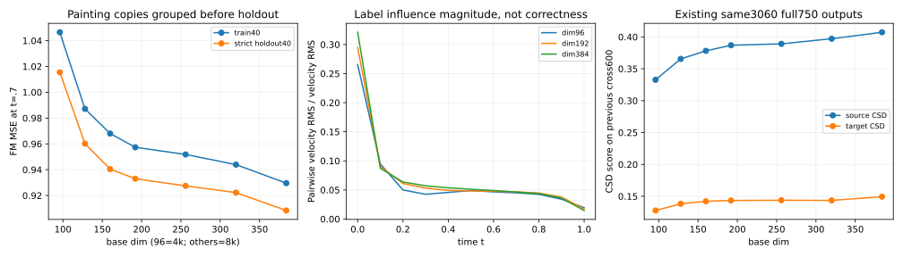
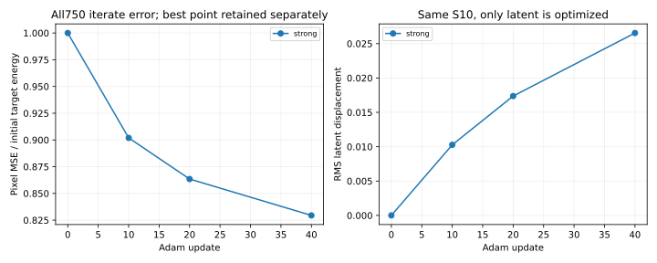

# V16完整数值附录

所有新方法各750任务，cross600/same150分开；同轮冻结判官，不跨4070旧版分数作差。
配对bootstrap以150源图为簇，重复簇保留；2000次逐项95%CI，未作多重比较校正。

dino_s=目标参考画作最大DINO相似度；dino_c=源图DINO相似度；LPIPS=相对源图感知距离。
target_top1/margin=冻结CSD五画派分类；dT=目标CSD相对源图的提升；G=目标DINO分−其余四派均值。
clip_s=目标画派CLIP参考分；style_affinity=(dino_s+clip_s)/2。所有相似度越高越好，LPIPS越低越好。

## 新实验完整均值

| arm | subset | dino_s | dino_c | lpips | target_top1 | target_margin | dT | G | clip_s | style_affinity |
|---|---|---|---|---|---|---|---|---|---|---|
| B_adapter | cross600 | 0.461589 | 0.749315 | 0.271192 | 0.106667 | -0.231938 | -0.000856 | -0.042744 | 0.679050 | 0.570319 |
| B_adapter | same150 | 0.638445 | 0.750362 | 0.268581 | 0.573333 | 0.088915 | -0.248079 | 0.176671 | 0.800136 | 0.719290 |
| B_adapter_wrong | cross600 | 0.460838 | 0.749563 | 0.270920 | 0.108333 | -0.234463 | -0.002763 | -0.043614 | 0.678378 | 0.569608 |
| B_adapter_wrong | same150 | 0.637879 | 0.749469 | 0.269649 | 0.566667 | 0.084277 | -0.251896 | 0.174477 | 0.799305 | 0.718592 |
| B_base | cross600 | 0.460642 | 0.750613 | 0.270001 | 0.106667 | -0.236304 | -0.004348 | -0.043721 | 0.677814 | 0.569228 |
| B_base | same150 | 0.638079 | 0.750495 | 0.268278 | 0.566667 | 0.086441 | -0.250966 | 0.175830 | 0.799744 | 0.718911 |
| B_teacher | cross600 | 0.467052 | 0.737865 | 0.282406 | 0.118333 | -0.220639 | -0.005923 | -0.040563 | 0.681278 | 0.574165 |
| B_teacher | same150 | 0.638079 | 0.750495 | 0.268278 | 0.566667 | 0.086441 | -0.250966 | 0.175830 | 0.799744 | 0.718911 |
| C_base | cross600 | 0.460630 | 0.750652 | 0.270002 | 0.106667 | -0.236133 | -0.004266 | -0.043746 | 0.677805 | 0.569217 |
| C_base | same150 | 0.638069 | 0.750438 | 0.268275 | 0.573333 | 0.086725 | -0.250919 | 0.175878 | 0.799770 | 0.718920 |
| C_h2_default | cross600 | 0.460298 | 0.750370 | 0.272353 | 0.111667 | -0.236307 | -0.001410 | -0.043891 | 0.678205 | 0.569252 |
| C_h2_default | same150 | 0.637718 | 0.750568 | 0.270654 | 0.553333 | 0.082988 | -0.248690 | 0.176196 | 0.800062 | 0.718890 |
| C_h2_strong | cross600 | 0.465598 | 0.741699 | 0.304030 | 0.123333 | -0.254415 | 0.026038 | -0.043751 | 0.678751 | 0.572174 |
| C_h2_strong | same150 | 0.638655 | 0.741235 | 0.299981 | 0.500000 | 0.057885 | -0.215989 | 0.172843 | 0.805167 | 0.721911 |
| C_h2_strong_wrong | cross600 | 0.465460 | 0.741544 | 0.307927 | 0.130000 | -0.251742 | 0.027797 | -0.044337 | 0.678811 | 0.572136 |
| C_h2_strong_wrong | same150 | 0.637286 | 0.742014 | 0.300440 | 0.493333 | 0.057596 | -0.211827 | 0.172431 | 0.805462 | 0.721374 |
| C_project_strong | cross600 | 0.460690 | 0.749149 | 0.272013 | 0.106667 | -0.233873 | -0.005277 | -0.043788 | 0.678665 | 0.569677 |
| C_project_strong | same150 | 0.637545 | 0.749333 | 0.271117 | 0.580000 | 0.082918 | -0.256327 | 0.175762 | 0.799111 | 0.718328 |

## A：严格FM留出替换后，t=.7

留出每派8幅，所有池内同stem副本均未被原FM训练使用，且排除Test750源与参考；训练诊断40幅保持原样（含1幅参考）。
初版5/40训练副本污染结果仍保留在runs/v16/A；本表用A_strict。96为4k，其他为8k，不能作同训练预算容量因果结论。

| dim | updates | train FM | strict holdout FM | wrong−correct | R_style | old Top1 | old DINO-C |
|---|---|---|---|---|---|---|---|
| 96 | 4000 | 1.046525 | 1.015506 | 0.000961 | 0.045023 | 0.106667 | 0.750635 |
| 128 | 8000 | 0.987136 | 0.960156 | 0.001041 | 0.049277 | 0.095000 | 0.776685 |
| 160 | 8000 | 0.967992 | 0.940454 | 0.001093 | 0.046170 | 0.095000 | 0.786161 |
| 192 | 8000 | 0.957349 | 0.932989 | 0.001233 | 0.046726 | 0.080000 | 0.791958 |
| 256 | 8000 | 0.951791 | 0.927420 | 0.001334 | 0.049291 | 0.083333 | 0.796183 |
| 320 | 8000 | 0.943909 | 0.922231 | 0.001237 | 0.046587 | 0.081667 | 0.800097 |
| 384 | 8000 | 0.929559 | 0.908349 | 0.001025 | 0.046537 | 0.066667 | 0.808282 |

## A：已有750输出的频带均方能量

按任务数加权批次均值。RGB为保存的uint8/255，latent为保存的scaled latent；两空间的绝对能量不可互比。
每列是该频带每系数均方，系数数量不同，三列不能直接相加当RGB能量。

| arm | domain | n | LL2 | H2 | H1 |
|---|---|---|---|---|---|
| W_dim96_conv_base | latent | 750 | 7.6097339 | 0.4268215 | 0.29223152 |
| W_dim96_conv_base | rgb | 750 | 5.4565673 | 0.0080707412 | 0.001169627 |
| S1_dim128 | latent | 750 | 7.613294 | 0.42820026 | 0.2930485 |
| S1_dim128 | rgb | 750 | 5.4575491 | 0.0085074232 | 0.0012276837 |
| S2_dim160 | latent | 750 | 7.6187596 | 0.42847499 | 0.29347519 |
| S2_dim160 | rgb | 750 | 5.4592579 | 0.0086842041 | 0.0012574669 |
| S3_dim192 | latent | 750 | 7.6197433 | 0.42859382 | 0.2933363 |
| S3_dim192 | rgb | 750 | 5.4571084 | 0.0087089769 | 0.0012598335 |
| S4_dim256 | latent | 750 | 7.6153306 | 0.42863288 | 0.29367684 |
| S4_dim256 | rgb | 750 | 5.4574029 | 0.0087180839 | 0.0012580912 |
| S5_dim320 | latent | 750 | 7.6140245 | 0.42953974 | 0.29390157 |
| S5_dim320 | rgb | 750 | 5.4575506 | 0.0088268167 | 0.0012785275 |
| S6_dim384 | latent | 750 | 7.6149874 | 0.42894628 | 0.2939764 |
| S6_dim384 | rgb | 750 | 5.4574993 | 0.0088368683 | 0.0012846352 |

## 配对差分完整区间

| comparison | dino_s | dino_c | lpips | target_top1 | target_margin | dT | G | clip_s | style_affinity |
|---|---|---|---|---|---|---|---|---|---|
| B_teacher vs B_base | +0.00641 [+0.00481,+0.00817] | -0.01275 [-0.01470,-0.01081] | +0.01240 [+0.01160,+0.01324] | +0.01167 [+0.00500,+0.02167] | +0.01567 [+0.01396,+0.01742] | -0.00157 [-0.00255,-0.00058] | +0.00316 [+0.00218,+0.00417] | +0.00346 [+0.00268,+0.00424] | +0.00494 [+0.00390,+0.00604] |
| B_adapter vs B_base | +0.00095 [+0.00056,+0.00135] | -0.00130 [-0.00173,-0.00085] | +0.00119 [+0.00103,+0.00135] | +0.00000 [-0.00500,+0.00500] | +0.00437 [+0.00379,+0.00494] | +0.00349 [+0.00312,+0.00387] | +0.00098 [+0.00071,+0.00123] | +0.00124 [+0.00099,+0.00149] | +0.00109 [+0.00084,+0.00135] |
| B_adapter_wrong vs B_adapter | -0.00075 [-0.00112,-0.00037] | +0.00025 [-0.00019,+0.00066] | -0.00027 [-0.00037,-0.00017] | +0.00167 [+0.00000,+0.00500] | -0.00253 [-0.00305,-0.00200] | -0.00191 [-0.00230,-0.00153] | -0.00087 [-0.00115,-0.00057] | -0.00067 [-0.00090,-0.00045] | -0.00071 [-0.00093,-0.00048] |
| C_h2_default vs C_base | -0.00033 [-0.00087,+0.00020] | -0.00028 [-0.00083,+0.00026] | +0.00235 [+0.00175,+0.00299] | +0.00500 [+0.00000,+0.01167] | -0.00017 [-0.00117,+0.00084] | +0.00286 [+0.00208,+0.00363] | -0.00014 [-0.00041,+0.00013] | +0.00040 [+0.00003,+0.00078] | +0.00003 [-0.00033,+0.00039] |
| C_h2_strong vs C_base | +0.00497 [+0.00205,+0.00778] | -0.00895 [-0.01200,-0.00593] | +0.03403 [+0.03118,+0.03688] | +0.01667 [+0.00333,+0.03000] | -0.01828 [-0.02339,-0.01266] | +0.03030 [+0.02776,+0.03274] | -0.00000 [-0.00115,+0.00108] | +0.00095 [-0.00003,+0.00193] | +0.00296 [+0.00141,+0.00450] |
| C_h2_strong_wrong vs C_h2_strong | -0.00014 [-0.00042,+0.00015] | -0.00016 [-0.00042,+0.00012] | +0.00390 [+0.00326,+0.00454] | +0.00667 [+0.00167,+0.01333] | +0.00267 [+0.00205,+0.00328] | +0.00176 [+0.00132,+0.00220] | -0.00059 [-0.00083,-0.00035] | +0.00006 [-0.00013,+0.00025] | -0.00004 [-0.00021,+0.00013] |
| C_project_strong vs C_h2_strong | -0.00491 [-0.00765,-0.00218] | +0.00745 [+0.00445,+0.01056] | -0.03202 [-0.03474,-0.02933] | -0.01667 [-0.03167,-0.00333] | +0.02054 [+0.01490,+0.02591] | -0.03131 [-0.03374,-0.02890] | -0.00004 [-0.00114,+0.00109] | -0.00009 [-0.00109,+0.00091] | -0.00250 [-0.00403,-0.00102] |
| C_project_strong vs C_base | +0.00006 [-0.00046,+0.00057] | -0.00150 [-0.00226,-0.00072] | +0.00201 [+0.00137,+0.00267] | +0.00000 [-0.00667,+0.00667] | +0.00226 [+0.00136,+0.00321] | -0.00101 [-0.00160,-0.00049] | -0.00004 [-0.00039,+0.00030] | +0.00086 [+0.00059,+0.00113] | +0.00046 [+0.00016,+0.00075] |

## 逐目标CSD Top1（各120 cross）

| arm | ER | Imp | Min | Roc | Uki |
|---|---|---|---|---|---|
| B_adapter | 0.00000 | 0.45833 | 0.05833 | 0.01667 | 0.00000 |
| B_adapter_wrong | 0.00000 | 0.45833 | 0.06667 | 0.01667 | 0.00000 |
| B_base | 0.00000 | 0.45000 | 0.06667 | 0.01667 | 0.00000 |
| B_teacher | 0.00000 | 0.50000 | 0.07500 | 0.01667 | 0.00000 |
| C_base | 0.00000 | 0.45000 | 0.06667 | 0.01667 | 0.00000 |
| C_h2_default | 0.00000 | 0.47500 | 0.06667 | 0.01667 | 0.00000 |
| C_h2_strong | 0.00000 | 0.60833 | 0.00833 | 0.00000 | 0.00000 |
| C_h2_strong_wrong | 0.00000 | 0.62500 | 0.01667 | 0.00833 | 0.00000 |
| C_project_strong | 0.00000 | 0.44167 | 0.07500 | 0.01667 | 0.00000 |

## 同源四目标切换响应 I

I=mean_t[S_t(y_t)−mean_{u≠t}S_t(y_u)]，每源先均值再汇总。相同输出忽略所有目标时为0。
此处是整个生成管线的响应，底座本身已条件化；H2单独label效应看strong/wrong配对，且两者保留同一true-target sigma。

| arm | DINO I | CLIP I | CSD I |
|---|---|---|---|
| B_adapter | -0.000032 | 0.000841 | 0.004215 |
| B_adapter_wrong | -0.000903 | 0.000187 | 0.002183 |
| B_base | -0.000866 | 0.000002 | 0.001405 |
| B_teacher | 0.001242 | 0.001412 | 0.005307 |
| C_base | -0.000886 | 0.000014 | 0.001492 |
| C_h2_default | -0.000896 | 0.000204 | 0.001685 |
| C_h2_strong | -0.001455 | 0.000876 | 0.004573 |
| C_h2_strong_wrong | -0.002013 | 0.001313 | 0.007722 |
| C_project_strong | -0.001029 | -0.000175 | 0.000493 |

## C：残差能量吸收率

吸收率=1−sum(重建残差能量)/sum(H2目标变化能量)，RGB和H2各自归一。不是相似度分数的百分比。
同样保留150源图簇重复抽样。有限步拟合为可达到的经验下界，不是不可表达性上界。

| case | subset | RGB fraction [CI] | H2 fraction [CI] | target MAE /255 | fit MAE /255 | latent RMS | delta cosine |
|---|---|---|---|---|---|---|---|
| strong | cross600 | +0.16734 [+0.16262,+0.17183] | +0.23854 [+0.23230,+0.24455] | 3.09774 | 2.89993 | 0.02449 | 0.36566 |
| strong | same150 | +0.18169 [+0.17617,+0.18664] | +0.25523 [+0.24837,+0.26157] | 3.24853 | 3.01626 | 0.02545 | 0.36875 |

## C：逐频带目标与拟合残差

target为H2目标−base的频带均方能量；residual为反演输出−H2目标。RGB clamp使目标自身也有少量LL2/H1变化。
LL2/H1 residual衡量对目标低频/细频的偏离，不能直接当作完整输出的绝对频带能量。

正交Haar对应RGB权重为LL2=1/16、H2=3/16、H1=3/4，加权后才能比较各频带对像素MSE的贡献。

| subset | band | target edit energy | fit residual energy | RGB weight | weighted residual |
|---|---|---|---|---|---|
| cross600 | LL2 | 2.36221803e-06 | 0.000173017929 | 0.0625 | 1.08136205e-05 |
| cross600 | H2 | 0.00164121635 | 0.00124971627 | 0.1875 | 0.0002343218 |
| cross600 | H1 | 1.06609051e-07 | 1.50505138e-05 | 0.75 | 1.12878854e-05 |
| same150 | LL2 | 2.21424076e-06 | 0.000202805777 | 0.0625 | 1.2675361e-05 |
| same150 | H2 | 0.00191312723 | 0.0014248412 | 0.1875 | 0.000267157725 |
| same150 | H1 | 1.3411451e-07 | 1.85327047e-05 | 0.75 | 1.38995285e-05 |

## C：全750迭代曲线

下表为迭代点均值，最终输出按每图目标函数最优点选择，因此不强制等于末步。

| case | step | pixel MSE | latent MSE | objective |
|---|---|---|---|---|
| strong | 0 | 0.000318154602 | 0 | 0.000318154602 |
| strong | 10 | 0.000286950433 | 0.000105588537 | 0.000287056021 |
| strong | 20 | 0.000274711332 | 0.000301813576 | 0.000275013145 |
| strong | 40 | 0.000263885524 | 0.000704724273 | 0.000264590249 |

