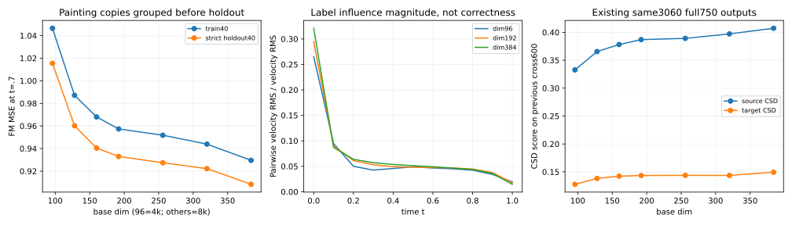
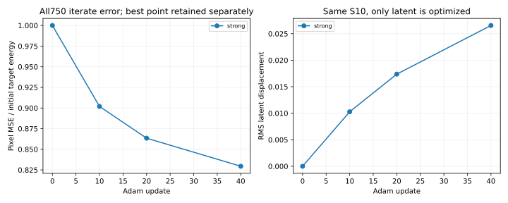

# V16：3060 A/B/C 完整结果与判断

日期：2026-11-16。A 严格留出诊断、B 训练、C 反演和 **9 组 × 750 任务独立评分均已完成**。本轮只有 Adapter 更新参数，V15、S10、H2 与判官全部冻结。

**结论：有小幅可测的正结果，但没有形成风格与内容指标的全面净胜。教师编辑有效，学生只学到一小部分；强 RGB-H2 的 DINO 收益经本次 latent 反演基本消失。现在仍不支持单纯加宽 V15 或扩大 H2。**

方案与实际参数见 [PLAN](PLAN.md)，全部均值、配对区间、逐画派结果、频带与曲线见 [NUMBERS](NUMBERS.md)，可机读表见 [metrics.csv](metrics.csv)，代码/权重/缓存哈希与数据审计见 [provenance.json](provenance.json)。

## 1. 协议与范围

- 新方法各完整 test750，主读数 cross600，same150 单列。五画派、冻结任务与参考；同轮在 3060 用同一评测代码和缓存评分。
- 全部解码使用 S10 官方封装，scaled latent 内部除 .18215，checkpoint 自带 post_quant_conv 恰好一次；没有训练或替换 decoder。
- 判官 DINOv2-small / CLIP / CSD / LPIPS 不参与训练或反演损失。没有把 Test750 源图用于 Adapter 监督。
- A 复用已有 Scaling checkpoint 与已有 750 输出；没有新增 Scaling 训练。C 每图 40 步，完整反演只做 strong；default/no-reg 反演的前 28 任务属于补充 pilot。
- 配对 CI 按 150 源图聚类 bootstrap 2000 次，保留重复簇计数，未校正多重比较。CI 不包含训练 seed/噪声 seed 不确定性；反复用于开发的 Test750 不是一次性盲测。

## 2. 新实验主表：cross600

| arm | DINO-S ↑ | CLIP-S ↑ | DINO-C ↑ | LPIPS ↓ | CSD Top1 ↑ | Margin ↑ |
|---|---|---|---|---|---|---|
| B_base | 0.46064 | 0.67781 | 0.75061 | 0.27000 | 10.67% | -0.23630 |
| B_teacher | 0.46705 | 0.68128 | 0.73786 | 0.28241 | 11.83% | -0.22064 |
| B_adapter | 0.46159 | 0.67905 | 0.74931 | 0.27119 | 10.67% | -0.23194 |
| B_adapter_wrong | 0.46084 | 0.67838 | 0.74956 | 0.27092 | 10.83% | -0.23446 |
| C_base | 0.46063 | 0.67780 | 0.75065 | 0.27000 | 10.67% | -0.23613 |
| C_h2_default | 0.46030 | 0.67821 | 0.75037 | 0.27235 | 11.17% | -0.23631 |
| C_h2_strong | 0.46560 | 0.67875 | 0.74170 | 0.30403 | 12.33% | -0.25441 |
| C_h2_strong_wrong | 0.46546 | 0.67881 | 0.74154 | 0.30793 | 13.00% | -0.25174 |
| C_project_strong | 0.46069 | 0.67867 | 0.74915 | 0.27201 | 10.67% | -0.23387 |

DINO-S、CLIP-S、CSD Top1/Margin 越高越好；DINO-C 越高、LPIPS 越低代表更保源。各指标衡量的方面不同，不用单项增加替代其他项。B_base 与 C_base 因 latent 存储与重新解码存在微小差异，所有差分均使用各自基线。

## 3. A：容量增加后，FM 变好但跨画派编辑变弱

最初按路径 ID 哈希取留出，事后发现同画作的不同前缀副本可跨训练/留出。原 A 的 40 幅留出中 5 幅有 FM 训练副本，原读数已降为历史诊断；补跑 **A_strict**，五派各 8 幅，所有池内同 stem 副本均未被原 FM 使用，且排除 Test750 源与参考。训练诊断的原 40 幅保持不变，其中 1 幅与参考重合。

| dim | updates | train FM@.7 | strict holdout FM@.7 | wrong−correct | R_style | old Top1 |
|---|---|---|---|---|---|---|
| 96 | 4000 | 1.046525 | 1.015506 | 0.000961 | 0.045023 | 10.67% |
| 128 | 8000 | 0.987136 | 0.960156 | 0.001041 | 0.049277 | 9.50% |
| 160 | 8000 | 0.967992 | 0.940454 | 0.001093 | 0.046170 | 9.50% |
| 192 | 8000 | 0.957349 | 0.932989 | 0.001233 | 0.046726 | 8.00% |
| 256 | 8000 | 0.951791 | 0.927420 | 0.001334 | 0.049291 | 8.33% |
| 320 | 8000 | 0.943909 | 0.922231 | 0.001237 | 0.046587 | 8.17% |
| 384 | 8000 | 0.929559 | 0.908349 | 0.001025 | 0.046537 | 6.67% |

严格留出的 FM@.7 从 dim96 的 1.01551 降至 dim384 的 0.90835，训练 FM 也下降。此样本没有呈现“加宽使 FM 留出误差上升”的走势。训练/留出的样本难度不同，40 幅诊断也有限，不能据此排除任何过拟合。

与此同时，已有 cross600 的目标 Top1 从 10.67% 降至 6.67%，DINO-C 从 .7506 升至 .8083；源派 CSD 均分 .3327→.4073，目标派 .1277→.1494。**更好的 FM 拟合没有转化为更好的目标画派转换，保源倾向反而更强。**

条件响应 R_style@.7 为 0.04502→0.04654，并未随加宽消失；correct/wrong FM 差仍约 .001 量级。它只证明标签有影响，不证明编辑方向正确，也不能定位 GroupNorm/FiLM 为根因。已有输出 RGB H2/H1 均方能量 dim96 约 .008071/.001170，dim384 约 .008837/.001285，不能把退化简单解释成高频能量消失。完整时间曲线与 latent/RGB 频带数值在 NUMBERS 和原始 CSV。

**缺项**：dim512 只有初始产物、没有 final.pt；96-8k checkpoint 未找到。96 为 4k，其余为 8k；未控制训练长度与 seed，因此不证明“96 是理论最优容量”，也不识别纯宽度的因果效应。

## 4. B：教师方向有收益，当前 Adapter 复制不足

教师复用 LD4 的 R1/N2C/局部风格库/区域 mask/候选回溯，但在 V15 输出重新锚定预算；这是 **V15 适配后的局部算子**，不能把历史 LD4 的 35.17% 当成本算子的保证。

初版固定 .5/1 归一化步长常超出新工作点预算，训练 cross 仅 5.7% 接受。该版保留为 pilot。修正为先乘每图 trust radius 后，训练/留出跨派接受率与非零率均 100%，平均每图残差 RMS .07488/.07408；预算断言通过。接受率是代理可行性，不是质量证据。

教师相对基线：DINO-S **+.006410**、CLIP-S **+.003464**、Top1 **+1.17pp**、Margin **+.015665**。Top1 的配对 95%CI 为 [+0.50000, +2.16667]pp，同时 DINO-C **−.012748**、LPIPS **+.012405**，方向均可检出。**这是风格收益与内容代价的交换，没有达到全面净胜。**

### 学生具体学到了多少

冻结 96 Conv，训练 256,516 参数零初始化残差 Adapter，1500 updates、有效 batch32。真实池 500 路径源 ×5 目标，包含同画派零编辑监督；损失是教师 delta MSE，加低频与残差正则，没有直接最大化 R1 Margin。内容项为 avgpool4(delta) 的代理约束。

| 拟合诊断 | 原训练 | 原留出 | 去重复后的学生留出 |
|---|---:|---:|---:|
| 相对 MSE（零编辑=1） | .89900 | .93439 | **.93502** |
| 全局方向余弦 | .32138 | .25685 | **.25574** |
| 预测 RMS | .02071 | .02064 | .02068 |
| 教师 RMS | .07569 | .07483 | .07484 |

去重留出 98 源/490 对/392 cross，CPU fp32；原表用 CUDA bfloat16，存在轻微精度差。预测幅度约教师的 28%，相对 MSE 只改善 6.5%，**不是充分拟合的学生**。

学生独立评分仍有正结果：DINO-S **+.000947**、CLIP-S **+.001236**、Margin **+.004367**；同时 DINO-C −.001298、LPIPS +.001191。Top1 保持 **10.67%**，差值 CI [-0.50000, +0.50000]pp。正确 Adapter 标签相对 wrong 的 DINO-S、CLIP-S 和 Margin 更好，故不能说它完全忽略标签；幅度很小，且 Top1 没有改善。

因此，本次不支持“蒸馏已把 LD4 的控制能力传给 V15”，也不支持“LD4 编辑方向没有用”。教师与学生是两个不同瓶颈；不能用拟合不足的学生单独否定教师。

## 5. C：RGB-H2 部分可拟合，但本次没有保住 DINO/Top1 增益

起点重新解码保存的 fp16 z；优化 scaled latent，冻结 S10，Adam lr=.002、40 步、lambda=.001，每图保留最优目标函数点。H2 default/strong/wrong 与 strong 反演各完整 750。没有把先前 RGB 量化或 latent 存储误差算进 H2 目标残差。

| subset | RGB吸收率 [95%CI] | H2吸收率 [95%CI] | 目标 MAE /255 | 拟合残差 MAE /255 | latent RMS |
|---|---|---|---|---|---|
| cross600 | 16.73% [16.26,17.18] | 23.85% [23.23,24.45] | 3.0977 | 2.8999 | 0.02449 |
| same150 | 18.17% [17.62,18.66] | 25.52% [24.84,26.16] | 3.2485 | 3.0163 | 0.02545 |

吸收率 = 1−总拟合残差能量/总目标编辑能量，是能量加权比值，不能当作 DINO 收益的保留百分比；逐图百分比的均值是另一个量。

### 多个指标的结论并不相同

强 H2 相对 C_base：DINO-S **+.004968**、Top1 **+1.67pp**，但 DINO-C **−.008952**、LPIPS **+.034029**，CSD Margin **−.018282**。CLIP-S 只 +.000946，其区间为 [-0.00003, +0.00193]。所以“强 H2 风格全面提升”不成立。

正确/错误网络 Style-ID 的 DINO-S 差只有约 .000138，CLIP-S 差约 .000061，区间均跨 0；wrong 的 Top1 反而更高（13.00% vs 12.33%）。正确标签在 LPIPS 上更好。**没有看到网络正确标签在目标风格分数上占优。** 此控制保留正确目标 sigma，只改变网络 label；不等于检验或排除 sigma 条件本身的作用。

反演输出相对 C_base：DINO-S **+.000060**（区间跨 0）、Top1 **不变**；相对强 H2，DINO-S −.004908、Top1 −1.67pp。强 H2 的这两项增益基本丢失。另一方面，CLIP-S **+.000861**、CSD Margin **+.002259** 仍有小幅改善，伴随 DINO-C −.001503、LPIPS +.002011。**不能把 DINO 增益消失写成所有风格信号都不可表达。**

### 频带耦合与收敛边界

cross600 的 H2 目标每系数能量 .0016412，拟合残差 .0012497；LL2/H1 拟合残差为 .0001730/.00001505，明显高于目标自身的小量泄漏。正交 Haar 加权后，LL2+H1 残差贡献约 .00002210 的像素 MSE，抵消了部分 H2 拟合收益。**当前 latent 更新会耦合其他频带，并非自由地只改 RGB-H2。**

| 全750迭代步 | pixel MSE | latent MSE | objective |
|---|---|---|---|
| 0 | 0.000318154602 | 0 | 0.000318154602 |
| 10 | 0.000286950433 | 0.000105588537 | 0.000287056021 |
| 20 | 0.000274711332 | 0.000301813576 | 0.000275013145 |
| 40 | 0.000263885524 | 0.000704724273 | 0.000264590249 |

20→40 步误差仍在下降，未证明稳定收敛。当前吸收率是 **该优化器、正则、half decoder、40 步的实得拟合**，不是 Jacobian 的精确投影，也不是 S10 的表达上限。不能声称“剩余 83% 在数学上不可表达”，也不能把它归因于历史 decoder 蒸馏；本轮没有相应受控对照。

## 6. 数据完整性与实施修正

ID 曾带 `d5__style__style__painting` / `wikiart__...` 前缀，原解析只剥一层，导致筛选声明不成立。事后按 NFC、最终双下划线分量、casefold 审计：

| 诊断集 | 路径源 | 唯一画作 stem | Test750 源重合 | 参考重合 | 存在原 FM 训练副本 |
|---|---:|---:|---:|---:|---:|
| 原 A train | 40 | 40 | 0 | 1 | 40 |
| 原 A holdout | 40 | 40 | 0 | 1 | 5 |
| B train | 500 | 497 | 0 | 12 | 500 |
| 原 B holdout | 100 | 100 | 0 | 3 | 12 |

B 有 2 幅画跨 Adapter 训练/留出重复，已从留出拟合诊断剔除；原训练权重与原 manifest 保留，未把清理描述成训练前排除。其余学生留出也不等于 V15 底座严格留出。参考画作重合意味着本轮不能宣称参考独立；审计按画作 stem，未做完整像素哈希身份证明。

A 严格留出已补跑。后续采样修复了 ID 归一化和同派副本去重，含任一 FM 训练副本的画不会进入该派 FM 留出；本次 B 实际采样代码另存为 `runs/v16/B/source_common_before_idfix.py`。原/修正样本和完整重复名单均在 provenance/data_audit 中。

教师步长、逐样本能量代理、S10 可微输入路径的修正与参数见 PLAN。batch2/channels-last 和初版全三种 C 反演试跑均保留为 pilot，没有冒充 750 证据。前 28 个 strong 主实验任务的计算规格相同，断点复用；default/no-reg 的 28 任务未进入主表。

## 7. 决策与交付

1. **保留 96 Conv 工作点**。现有证据指向 FM 拟合与迁移目标不一致，继续加宽不是已验证的解决方式；GroupNorm/FiLM 的具体因果机制仍未被识别。
2. **B 是小幅正结果，不是成功迁移 LD4 能力**。若继续这条线，应先解决学生对明确教师残差的拟合和实际收益，保持独立评分，不把教师接受率当质量。
3. **C 支持继续研究独立 RGB 编辑的价值，但没有证明其不可替代**。强 H2 主要体现特定指标收益与内容代价，网络标签特异性弱；直接扩大 H2 缺少依据。新的 RGB 目标需要明确画派特异监督。

实现位于 [exp/v16](../../exp/v16)、[Adapter](../../src/model/edit_adapter.py)、[S10 可微封装](../../src/utils/vae.py)。Adapter 权重：[adapter.pt](../../runs/v16/B/adapter.pt)。小体积实验档案：[export_bundle.zip](../../runs/v16/export_bundle.zip)；完整逐任务 RGB 张量留在 3060 的 `I:/Latent_Style/WEAVE/runs/v16/raw/`，没有输出逐任务 PNG。

已验证实际 S10 输入梯度有限非零、可微/推理 forward 完全相同、Adapter 零初始化、九组任务各 750/600/150 完整覆盖、教师预算和冻结判官链路。未进行无关全仓测试，未修改其他实验权重。
