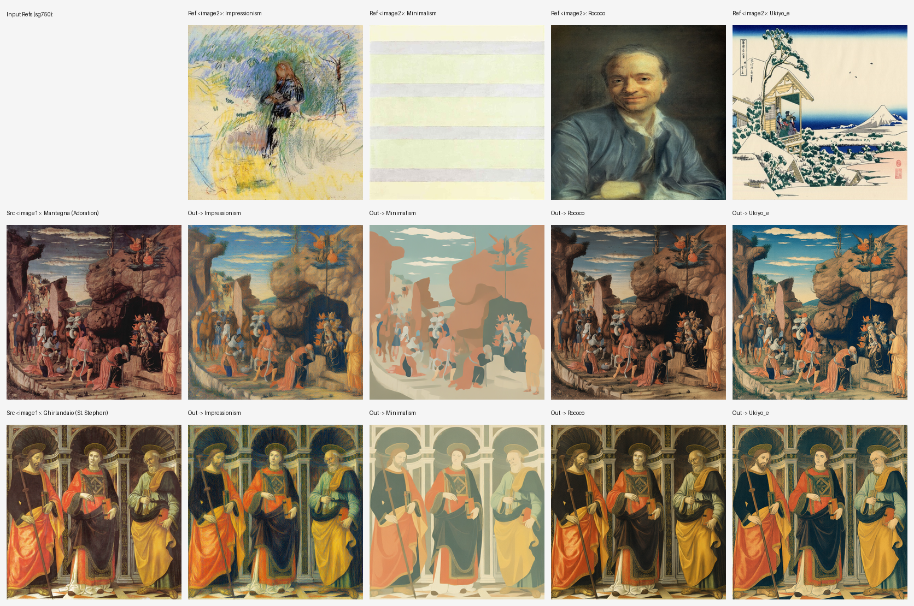

# Qwen-Image-2.1-Turbo Cross600 实测报告（RTX 3060 12GB, 4-bit NF4）

> 评测日期：2026-11-25 | 执行节点：`ssh 3060`（RTX 3060 12GB, Windows WDDM）| 脚本：[eval_qwen_turbo.py](../../exp/v28_unified/eval_qwen_turbo.py) | 汇总数据：[qwen_turbo_cross600_summary.json](qwen_turbo_cross600_summary.json)

---

## 一、实验环境、磁盘整理与 12GB 量化部署

1. **存储整理（`3060` `I:` 盘清理）**：
   - 核验并删除已完整产出 `eval.json` 的历史冗余原始批次张量 `batch_*.pt`（覆盖 `runs/v15/eval/raw`、`v17/raw`、`v18`、`v22`–`v27` 与 `runs/v8/*/gen/batch_*.pt`，完整保留全部 `eval.json`、`summary_arm.json`、`features.pt`、`png_750/` 与训练权重），以及遗留 Linux `.whl` 包、已废弃的 `sd-vae-ft-ema` 缓存与 `.lmstudio` 未完成 `.part` 文件。
   - `I:` 盘可用空间由 **`5.3 GB`** 恢复至 **`127.41 GB / 480.46 GB`**。
2. **模型拉取与隔离环境（`F:` 盘）**：
   - 从 ModelScope 拉取官方 `Qwen/Qwen-Image-2.1-Turbo`（32 个文件，约 `30.2 GiB`）至 `F:\models\Qwen-Image-2.1-Turbo`。
   - 系统环境原装 `diffusers 0.38.0` 尚无 `QwenImage21Pipeline`，故在 `F:\src\diffusers` 拉取 `diffusers` 主分支（`0.44.0.dev0`），并新建隔离环境 `F:\venvs\qwen`（继承系统 `torch 2.11.0+cu128` 与 `bitsandbytes 0.50.0`，隔离升级 `transformers 5.24.0`、`accelerate 1.16.0`、`huggingface_hub 2.4.0`）。
3. **12GB 显存 + 25.6GB 内存适配方案**：
   - 原始 BF16 权重总计 `32.45 GB`（`text_encoder 17.53 GB` + `transformer 14.23 GB` + `vae 0.68 GB`），直接加载或联合 CPU offload 会触发 12GB 显存或 17.2GB 可用内存溢出。
   - 采用**分组件顺序 `bitsandbytes` 4-bit NF4 量化**（`compute_dtype=bfloat16, bnb_4bit_use_double_quant=True`）后独立落盘至 `F:\models\Qwen-Image-2.1-Turbo-bnb4`：
     - `text_encoder`（Qwen3-VL-8B）：`17.53 GB → 6.38 GB`
     - `transformer`（7B DiT）：`14.23 GB → 3.67 GB`
     - `vae`（BF16）：`0.68 GB`（全模型共 **`10.73 GB`**）
   - 推理期先逐组件加载并移至 CPU 再启用 `pipe.enable_model_cpu_offload()`，并开启 TF32（`allow_tf32=True`, `float32_matmul_precision="high"`），避免加载阶段双组件同时驻留显存。

---

## 二、Prompt 与分辨率对照探测（4 任务预检）

在全量运行前，对同一批跨画派任务（`Early_Renaissance -> Impressionism / Minimalism / Rococo / Ukiyo_e`）做了 4 任务小样本对照：

- **初始提示词（过于保守）**：`"Transfer ... while preserving the exact subjects, layout, and structural details of the first image."` 导致 `Minimalism`（`DINO-C=0.9360, top1=0`）与 `Rococo`（`DINO-C=0.9324, top1=0`）几乎原样复刻，并在 `Impressionism` 出现将参考图人物直接拼贴进画面中部的伪影。
- **提示词对照 `Probe A` vs `Probe B`（`512×512`）**：
  - `Probe A`（`"Redraw image 1 in the {target_style} artistic style, brushwork, and color palette of image 2, keeping the scene and subjects of image 1."`）：`16.10 s/img`，成功驱动 `Minimalism` 重绘（`DINO-C=0.6461`），四画派均体现明显目标笔触与调色板。
  - `Probe B`（`<image1>/<image2>` 无显式流派词）：`18.29 s/img`，`Minimalism`（`DINO-C=0.9193`）与 `Rococo`（`DINO-C=0.9738`）仍极度保守。
- **分辨率对照 `Probe A (512×512)` vs `Probe C (1024×1024)`**：
  - `Probe C`（`gen_res=1024, cond_res=1024`）单图耗时 **`70.09 s`**、峰值显存 **`11,521 MB`**（接近 12GB WDDM 极限，全量 600 张需 ~12 小时），且 `Impressionism` / `Minimalism` 的 `DINO-S`（`0.4852 / 0.1498`）反而低于 `512×512`（`0.5713 / 0.1683`）。
  - 因此正式全量评测锁定 **`Probe A` + `512×512`（`gen_res=512, cond_res=512`）**，与 WEAVE `512×512` 评测口径对齐。

---

## 三、Cross600 全量评测配置与结果（`n=600`）

- **任务集与参考图**：[tasks_750.json](../../eval_protocol/tasks_750.json) 全部 `is_cross=True` 任务（150 源图 × 4 跨画派 = **600**），每任务传入双图 `image=[src_img, ref_img]`，其中 `ref_img` 来自与 `StyleGallery` / `Hist2Style` 完全一致的冻结单参考清单 `sg750_manifest.csv`（每目标画派 1 张训练集干净参考图）。
- **采样设置**：Checkpoint 自带 8 步 `sample_sigmas`、`true_cfg_scale=1.0`、`use_kv_cache=True`、`seed = 42 + idx`。
- **裁判协议**：独立子进程执行 `python -m src.eval.measure`（冻结 `CSD ViT-L` + `DINOv2-small` + `CLIP ViT-B/32` + `LPIPS AlexNet`）。

### 1. 总体指标与横向对比

| 模型 / 口径 | `DINO-C` ↑ | `DINO-S` ↑ | `CSD Top-1` ↑ | `CLIP-S` ↑ | `Style Affinity` ↑ | `LPIPS` ↓ | $S_{\mathrm{LSE}}$ ↑ | $M_{-4}$ ↑ | 延迟 (`ms/img`) ↓ | 硬件 |
| --- | ---: | ---: | ---: | ---: | ---: | ---: | ---: | ---: | ---: | --- |
| **`Qwen-Image-2.1-Turbo (bnb4, 512px)`** | **`0.7016`** | **`0.4660`** | **`42.17%`** | **`0.6975`** | **`0.5817`** | **`0.6256`** | **`6.309`** | **`0.5301`** | **`16,070.78`** | RTX 3060 12GB |
| `Seedream 4.5` *(商业闭源)* | `0.7343` | `0.3885` | `37.30%` | `0.6744` | `0.5314` | `0.5202` | `5.629` | `0.4534` | `2,000.0` | API |
| `StyTr2` *(外部 Transformer)* | `0.7023` | `0.4074` | `39.50%` | `0.6560` | `0.5317` | `0.7386` | `5.773` | `0.4717` | `3,040.0` | — |
| `StyleGallery` *(外部扩散对齐)* | `0.6113` | `0.5604` | `52.50%` | `0.7259` | `0.6432` | `0.5576` | `6.017` | `0.5831` | `30,400.0` | RTX 3060 12GB |
| `PRISM-1` (`V19.S2`, 1-NFE) | `0.7440` | `0.4431` | `44.33%` | `0.6880` | `0.5655` | `0.5057` | `6.273` | `0.5116` | `17.04` | RTX 4090 |
| `V28 Adv1NFE (l075)` *(1-NFE)* | `0.6761` | `0.4868` | `56.50%` | `0.7172` | `0.6020` | `0.5257` | `6.302` | `0.5588` | `14.36` *(b1)* | RTX 4090 |

- **150 源聚类 Bootstrap 95% CI**（`Qwen-Image-2.1-Turbo`）：
  - `CSD Top-1`：`42.17%` `[37.00%, 47.17%]`
  - `DINO-S`：`0.4660` `[0.4485, 0.4841]`
  - `DINO-C`：`0.7016` `[0.6669, 0.7353]`
  - `CLIP-S`：`0.6975` `[0.6870, 0.7077]`
  - `Style Affinity`：`0.5817` `[0.5692, 0.5943]`
  - `LPIPS`：`0.6256` `[0.6076, 0.6438]`
  - `Target Margin`：`-0.0446` `[ -0.0845, -0.0070]` · `dT`：`+0.2320` · `G`：`+0.0494` · `pred_eq_src`：**`56.83%`**

### 2. 分目标画派表现（Cross120 × 5）

| 目标画派 | `CSD Top-1` ↑ | `DINO-S` ↑ | `DINO-C` ↑ | `CLIP-S` ↑ | `Style Affinity` ↑ | `LPIPS` ↓ | `Target Margin` | `pred_eq_src` |
| --- | ---: | ---: | ---: | ---: | ---: | ---: | ---: | ---: |
| `Early_Renaissance` | `15.00%` | `0.4699` | `0.7939` | `0.6737` | `0.5718` | `0.5413` | `-0.2748` | `82.50%` |
| `Impressionism` | `34.17%` | `0.5523` | `0.7294` | `0.7038` | `0.6280` | `0.6311` | `-0.0582` | `65.83%` |
| `Minimalism` | `63.33%` | `0.2880` | `0.6628` | `0.6874` | `0.4877` | `0.7141` | `+0.0330` | `35.83%` |
| `Rococo` | `20.00%` | `0.4739` | `0.7762` | `0.6261` | `0.5500` | `0.5296` | `-0.2290` | `79.17%` |
| `Ukiyo_e` | **`78.33%`** | `0.5458` | `0.5455` | **`0.7963`** | **`0.6710`** | `0.7120` | **`+0.3058`** | `20.83%` |

- **CSD 混淆矩阵**（行=目标画派 `[ER, Imp, Min, Roc, Uki]`，列=预测画派）：
  - `Early_Renaissance`: `[18, 24, 15, 33, 30]`
  - `Impressionism`: `[25, 41, 5, 22, 27]`
  - `Minimalism`: `[8, 1, 76, 5, 30]`
  - `Rococo`: `[29, 25, 12, 24, 30]`
  - `Ukiyo_e`: `[14, 2, 0, 10, 94]`

### 3. 推理延迟与显存统计（RTX 3060 12GB）

- 统计样本：$n = 599$（去除第 0 张预热图；含全部 `encode_prompt` + 8 步 `transformer` + `vae.decode` + CPU offload 开销）：
  - **Mean**：**`16,070.78 ms/img`**（`16.07 s/img` = `0.0622 img/s`）
  - **Median**：**`15,745.35 ms/img`**（`15.75 s/img`）
  - **P95**：**`18,601.11 ms/img`**（`18.60 s/img`）
  - **600 张总计生成时间**：`9,651.4 s`（约 **`2.68 小时`**）
  - **显存峰值**：中位数 **`7,289.2 MB`**，最大值 **`7,322.5 MB`**（稳态控制在 12GB 显卡 61% 附近，零 OOM）

---

## 四、样例视觉检视与核心结论

1. **显著超越 `Seedream 4.5` 的风格迁移强度**：在同协议 Cross600 上，开源 8-step `Qwen-Image-2.1-Turbo (bnb4)` 的 `CSD Top-1`（`42.17%`）与 `DINO-S`（`0.4660`）分别高出商业闭源 `Seedream 4.5` **`+4.87pp`** 与 **`+0.0775`**，综合得分 $S_{\mathrm{LSE}}$（`6.309`）与 $M_{-4}$（`0.5301`）也明显高于 `Seedream 4.5`（`5.629` / `0.4534`）与 `StyTr2`（`5.773` / `0.4717`）。
2. **画派极化与结构保源惯性仍然显著**：模型在强版画/色块风格（`Ukiyo_e` `78.33%`、`Minimalism` `63.33%`）上能够大幅重绘；但在相近古典油画流派（`Early_Renaissance` `15.00%`, `pred_eq_src=82.50%`；`Rococo` `20.00%`, `pred_eq_src=79.17%`）上仍呈现强源图锁定（总计 `56.83%` 样本被 CSD 判回原画派）。
3. **消费级显卡速度—质量位置**：即便经 8-step Turbo 蒸馏并压缩至 4-bit NF4，`3060` 端到端单图仍需 **`16.07 s`**；在相近或更高的 `DINO-C ≈ 0.70` 区间，专用单步模型（如 `PRISM-1` 与 `V28 Adv1NFE l060/l075`）依然在 `CSD Top-1`、`LPIPS` 保真度与推理速度（快约 **2–3 个数量级**）上占据明显优势。
