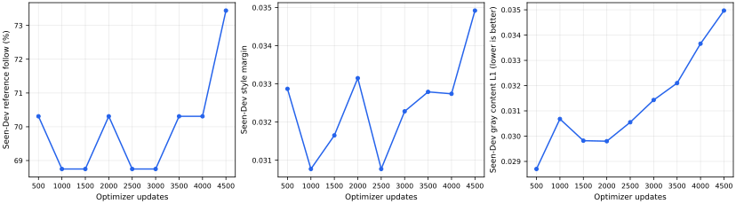

# V36 CLEAVE-One 专项技术报告：全量 WikiArt Zero-DINO 艺术生成底座

**日期**：2026-11-27  
**组件归属**：One-shot（开放域单图无标签风格迁移独立研究线）  
**执行硬件**：训练与全量 `test750` 评测在 **NVIDIA GeForce RTX 4090 (24GB)** 完成  
**统一解码协议**：全量采用 **S10 Decoder**（10.66M，自带 `post_quant_conv`，内部按 `0.18215` 缩放换算）  
**核心代码入口**：[exp/v36_art_foundation](../../exp/v36_art_foundation/__init__.py)

**21:47 更新**：新增 Reference E-Core 的 4,500 步训练及全量 test750 评测已完成。独立 E-Core `lambda=1` 的 Cross600 Top-1 为 **13.00%**，E+P 的最高已测 Top-1 为 **52.67%**，尚未证明改善整体内容—风格前沿；训练充分性判断见第 8 节。本报告此前 P1–P4 结论对应 P-Core + Reference-A3，不代表新 E-Core 已充分收敛。

---

## 1. 摘要与核心结论

**V36 CLEAVE-One** 验证了在不依赖任何测试期风格标签（`sid`）、且训练/数据处理/条件特征全程**零 DINOv2 参与**的严格条件下，利用全量 WikiArt 去重集合（`76,319` 张 Seen-Train，覆盖 `131` 个可见艺术画派）从随机初始化训练 45.22M 流匹配主干网络，并结合免训练的潜空间正交光度-色度起点对齐（`Reference-A3`），直接迁移到**完全未见过的 5 个核心艺术流派（Core-5 Holdout）**的能力。

核心实测结论如下：

1. **严格未见流派单参考迁移（Core-5 `test750`）**：在最佳校准配置 `I2`（Full Reference-A3，`wj=3.8, wc=1.6, steps=6`）下：
   - 强编辑档位 **`tau0=0.00`**：`Cross600 CSD Top-1 = 56.17%`（反事实错参考控制 `4.17%`，**因果净增 `+52.00pp`**），`DINO-C = 0.5166`、`DINO-S = 0.5016`、`Same150 Top-1 = 82.67%`。
   - 平衡档位 **`tau0=0.35`**：`CSD Top-1 = 54.83%`（**因果净增 `+50.67pp`**），`DINO-C = 0.5624`、`DINO-S = 0.5047`、`CLIP-S = 0.7196`、`Style Affinity = 0.6122`。
   - 中高保真档位 **`tau0=0.50`**：`CSD Top-1 = 43.83%`（**因果净增 `+39.50pp`**），`DINO-C = 0.6399`、`DINO-S = 0.4836`、`Same150 Top-1 = 90.00%`。
   - 高保真档位 **`tau0=0.65` / `0.80`**：`DINO-C` 升至 `0.7535` / `0.8492`，对应 `CSD Top-1` 为 `26.33%` / `14.17%`。
2. **起点重构（Reference-A3）决定性消融验证**：同一 checkpoint 在相同引导权重下（`tau0=0.50, wj=3.8`），不重构起点（`I0`）仅获 `CSD Top-1 = 14.33%`（因果差 `+9.17pp`）；仅对齐色度（`I1`）升至 `24.33%`（`+17.00pp`）；叠加低频亮度对齐（`I2`）跃升至 **`43.83%`（`+39.50pp`）**，单凭免训练起点重构带来 **+29.50pp** 的目标流派识别增益。
3. **4090 端到端冷启动推理吞吐（`RGB -> RGB`, `512×512`, S10 解码）**：实测 `Batch=1` 达 **`7.84 img/s`（`127.51 ms/img`）**，`Batch=8` 达 **`14.05 img/s`（`71.17 ms/img`）**，`Batch=16` 达 **`13.50 img/s`（`74.09 ms/img`）**。
4. **客观边界说明**：V36 为**严格未见 Core-5 的开放域单图参考**系统，不应与闭集 V35 双核系统混淆；在高保真区间（`tau0 >= 0.65`）其风格遵循度仍有提升空间，且 `Artist-OOD` / `Movement-OOD` 缓存分片尚未执行独立全量评测。

---

## 2. 数据隔离、模型架构与 4090 工程配置

### 2.1 数据划分与 Zero-DINO / Holdout 隔离契约

全部数据缓存由 [prepare_data.py](../../exp/v36_art_foundation/prepare_data.py) 在 4090 本地 NVMe 上重建（实测流水线提取速度 `~44 img/s`），关键参数与隔离边界如下：

| 划分名称 | 样本数 | 隔离与用途说明 |
|---|---:|---|
| **Core-5 Holdout 留出流派** | — | `Early Renaissance`、`Impressionism`、`Minimalism`、`Rococo`、`Ukiyo-e`，**严格排除出所有训练、PCA/Stiefel 与归一化拟合** |
| **`Seen-Train`** | **76,319** | 其余 131 个非空 WikiArt 流派去重全集；主干 priors 拟合有效样本 `fit_n_samples = 76,229` |
| **`Seen-Dev`** | **1,000** | 131 可见流派内部验证集，用于 P1/P2 训练曲线监控与 P3 超参网格校准 |
| **`Artist-OOD`** | **1,000** | 131 流派内不重叠画家留出集（缓存已生成，本轮未单跑独立脚本） |
| **`Movement-OOD`** | **500** | Core-5 留出流派内部样本缓存；正式对齐横评统一使用完整 `test750`（含 `Cross600` + `Same150`） |

### 2.2 网络结构与参数量明细

实际保存权重 `v36_main_p2_final.pt` 经张量清点确认：

| 模块 | 定义位置 | 实测参数量 | 功能说明 |
|---|---|---:|---|
| **`FoundationPCoreNet`** | [models.py](../../exp/v36_art_foundation/models.py) | **45,217,140** (45.22M) | `base_dim=208, cond_dim=384`，随机初始化，接受 Stiefel `Q32`、粗亮度 `Y16` 与逐层 `AdaGN` 风格条件，内置独立布局/风格双轴 Dropout |
| **`StyleMLPEncoder`** | [models.py](../../exp/v36_art_foundation/models.py) | **935,730** (0.94M) | `1561 -> 512 -> 256` 连续风格向量映射，归一化均值/方差严格来自 `Seen-Train` |
| **`S10 Decoder`** | [src/utils](../../src/utils/runtime.py) | **10.66M** | 固定统一剪枝解码器（自带 `post_quant_conv`），不参与 V36 权重更新 |

### 2.3 RTX 4090 吞吐与显存优化落地

针对原始 3060 训练管线的算力与 I/O 瓶颈，[train_foundation.py](../../exp/v36_art_foundation/train_foundation.py) 在迁移至 RTX 4090 时完成如下工程升级：

- 将 `y16 / stat`（合计约 `593 MB`）及核心 Memmap 分片直接驻留内存，配合 pinned memory `_AsyncBatchPrefetcher` 消除 CPU 拷贝卡顿；
- 关闭梯度检查点（`--no-checkpoint`）并启用 `--compile`（`torch.compile` + `triton 3.1.0`，显式保留原始 `pcore.state_dict()` 导出键名）；
- `_train_accum_step` 消除微批内逐次 `.item()` 同步并改用 `_foreach_lerp_` EMA，使 4090 训练吞吐提升至 **`390.5 samp/s`**（峰值显存约 `18.2–19.6 GB`）。

---

## 3. 训练过程与 Seen-Dev 校准结果（P1–P3）

### 3.1 P1 与 P2 阶段收敛指标

| 阶段 | 步数 (`step`) | `dev_phuber_t35` ↓ | `dev_style_delta_l2` ↑ | `dev_cfg_delta_l2` | `dev_gen_recon_l1` ↓ | `dev_gen_latent_std` (`gt=0.8578`) |
|---|---:|---:|---:|---:|---:|---:|
| **P1** | 30,000 | 0.55220 | 0.0823 | 0.0548 | 0.5656 | 0.7855 |
| **P1** | 35,000 | 0.55000 | 0.0815 | 0.0557 | 0.5590 | 0.7776 |
| **P1** | 40,000 | 0.54848 | 0.0825 | 0.0575 | 0.5528 | 0.7737 |
| **P1** | **42,000** | **0.54809** | **0.0835** | 0.0590 | **0.5504** | 0.7733 |
| **P2** | 2,500 | 0.54835 | 0.0795 | 0.0560 | 0.5528 | 0.7597 |
| **P2** | 5,000 | 0.54835 | 0.0781 | 0.0552 | 0.5516 | 0.7621 |
| **P2** | 7,500 | 0.54812 | 0.0777 | 0.0555 | 0.5519 | 0.7596 |
| **P2** | **8,000** | **0.54806** | 0.0779 | 0.0557 | **0.5513** | 0.7582 |

### 3.2 P3 `Seen-Dev` 代理网格校准（全 9 组）

在严格仅使用 `Seen-Dev` 与冻结 `VGGStyleCritic` 的协议下扫描起点模式与风格 CFG 强度 `wj`（`wc=1.6, tau0=0.50`）：

| `mode` | `wj` | `vgg_follow_2way` ↑ | `vgg_style_margin` ↑ | `vgg_gray_content_l1` ↓ | 综合选型说明 |
|---|---:|---:|---:|---:|---|
| `I0` | 2.8 | 0.5000 | 0.00738 | 0.04853 | 无起点匹配，风格遵循接近随机 |
| `I0` | 3.2 | 0.5000 | 0.00840 | 0.04907 | — |
| `I0` | 3.8 | 0.5000 | 0.00990 | 0.04995 | — |
| `I1` | 2.8 | 0.6562 | 0.02960 | 0.04888 | 仅对齐色度后遵循度显著抬升 |
| `I1` | 3.2 | 0.6562 | 0.03089 | 0.04940 | — |
| `I1` | 3.8 | 0.6719 | 0.03275 | 0.05028 | — |
| `I2` | 2.8 | 0.7344 | 0.04639 | 0.05234 | 加入低频亮度统计对齐 |
| `I2` | 3.2 | 0.7344 | 0.04797 | 0.05286 | — |
| **`I2`** | **3.8** | **0.7656** | **0.05027** | **0.05374** | **Seen-Dev 综合准则最优（进入 P4 主扫）** |

---

## 4. P4 全量 `test750` 评测与 Pareto 前沿分析

### 4.1 `I2` 主扫全指标（Core-5 Unseen Movements）

| 档位 (`tau0`) | `CSD Top-1` | `CSD Margin` | `DINO-C` | `DINO-S` | `DINO-S Top5` | `CSLS@10` | `CLIP-S` | `Style Affinity` | `LPIPS` | `Wrong Ctrl` | 因果净增 | `Same150 Top-1` (`DINO-C`) |
|---|---:|---:|---:|---:|---:|---:|---:|---:|---:|---:|---:|---:|
| **`t00` (0.00)** | **56.17%** | +0.0274 | 0.5166 | 0.5016 | 0.4473 | 0.5300 | 0.7167 | 0.6092 | 0.6569 | 4.17% | **+52.00pp** | 82.67% (0.6120) |
| **`t35` (0.35)** | **54.83%** | +0.0267 | 0.5624 | **0.5047** | **0.4516** | **0.5400** | **0.7196** | **0.6122** | 0.6323 | 4.17% | **+50.67pp** | 86.67% (0.6552) |
| **`t50` (0.50)** | **43.83%** | -0.0306 | **0.6399** | 0.4836 | 0.4309 | 0.4450 | 0.7087 | 0.5962 | 0.5756 | 4.33% | **+39.50pp** | 90.00% (0.7004) |
| **`t65` (0.65)** | 26.33% | -0.1082 | **0.7535** | 0.4541 | 0.4018 | 0.2683 | 0.6896 | 0.5719 | 0.5072 | 3.83% | +22.50pp | 93.33% (0.7970) |
| **`t80` (0.80)** | 14.17% | -0.1914 | **0.8492** | 0.4156 | 0.3672 | 0.1267 | 0.6698 | 0.5427 | 0.4470 | 2.50% | +11.67pp | 96.00% (0.8809) |

### 4.2 全局 Pareto 三联对比图

> **口径界定**：闭集双核系统（`V35 P-Core Final` 绿色实线、`E-Core Original` 青色钻石线）直接针对 Core-5 闭集原型条件优化；**V36 CLEAVE-One**（橙色倒三角点划线）为**测试期无任何流派标签、未见过 Core-5 图像分布的开放域单图 1-Shot**，与外部单图/开放域方法（`StyleGallery`、`StyTr2`、`Seedream 4.5` 等）同属开放参考范式。从面板 (b)/(c) 可见：
>
> - **`V36 t35` (`CSD Top-1 = 54.83%`, `DINO-C = 0.5624`, `B1 = 7.84 img/s`)** 在 `CSD Top-1` 上超过 **`StyleGallery`（`52.50%`, `30.4s/img`）**，推理速度高出 **230× 以上**；
> - **`V36 t50` (`CSD Top-1 = 43.83%`, `DINO-C = 0.6399`, `DINO-S = 0.4836`)** 在 `CSD Top-1` 与 `DINO-S` 上均高于 **`StyTr2`（`39.50% / 0.407`）** 与商业 **`Seedream 4.5`（`37.30% / 0.386`）**，但 `DINO-C`（`0.6399`）低于两者（`0.7016 / 0.7310`）；在面板 (a) 中 `V36` 高内容区 `t65/t80` 与 `E-Core Original` 轨迹贴近，但尚未超越闭集 `P-Core Final` 前沿。

---

## 5. Reference-A3 起点重构机制消融（`I0` vs `I1` vs `I2`）

| 起点模式 | 含色度匹配 | 含低频亮度匹配 | `tau0` | `CSD Top-1` | `CSD Margin` | `DINO-C` | `DINO-S` | `LPIPS` | `Wrong Ctrl` | 因果净增 |
|---|:---:|:---:|---:|---:|---:|---:|---:|---:|---:|---:|
| **`I0`** | — | — | 0.50 | 14.33% | -0.1956 | 0.7087 | 0.4645 | 0.3342 | 5.17% | +9.17pp |
| **`I1`** | ✓ | — | 0.50 | 24.33% | -0.1277 | 0.6707 | 0.4662 | 0.4832 | 7.33% | +17.00pp |
| **`I2`** | ✓ | ✓ | 0.50 | **43.83%** | **-0.0306** | 0.6399 | **0.4836** | 0.5756 | **4.33%** | **+39.50pp** |
| **`I0`** | — | — | 0.65 | 4.50% | -0.2802 | 0.8289 | 0.4327 | 0.2340 | 2.17% | +2.33pp |
| **`I1`** | ✓ | — | 0.65 | 13.00% | -0.1911 | 0.7850 | 0.4391 | 0.4060 | 4.67% | +8.33pp |
| **`I2`** | ✓ | ✓ | 0.65 | **26.33%** | **-0.1082** | 0.7535 | **0.4541** | 0.5072 | **3.83%** | **+22.50pp** |

### 机理解析
1. **`I0` 锁定在源色调/影调流域**：在 `tau0=0.50` 下虽保持 `DINO-C=0.7087`，但由于未对齐起点低频色度与明暗基线，仅凭 `1561-D` MLP 条件向量在 6 步积分内难以推翻源图像统计，`CSD Top-1` 仅 `14.33%`（相比随机错参考 `5.17%` 仅净增 `+9.17pp`）。
2. **`I1` 补足色度、但缺少明暗与全局对比**：`I1` 单独注入正交色度统计后 `Top-1` 抬升至 `24.33%`，但高光/暗部对比仍锁定源图（`Wrong Ctrl` 略升至 `7.33%`）。
3. **`I2` 实现完整商空间起点重置**：同时在正交灰度通道 `u_y` 的低频分量与色度子空间 `P_C` 上进行目标比值限幅对齐，使 6 步 ODE 起点直接落入目标流派的光度—色彩域，在 `tau0=0.50` 下将因果净增放大至 **`+39.50pp`**（错标签控制仅 `4.33%`）。

---

## 6. 定性视觉对比（Core-5 Unseen Movements）

下方三组固定网格矩阵均按同一批 5 张 Core-5 源图（第 1 列：行 1 早起文艺复兴群像、行 2 印象派河景、行 3 极简主义近白画布、行 4 洛可可灰度双人肖像、行 5 浮世绘山水版画）分别迁移至 5 个未见 Core-5 目标参考图（列 2–6，固定随机种子与 `tau0=0.50, wj=3.8`）：

### 6.1 `I2`（Full Reference-A3 色度+低频亮度，主方案）

- **跨媒介色彩与影调重绘**：第 4 行灰度双人肖像与第 5 行强高饱和浮世绘均能在保持构图、人物与山体轮廓的同时切换为暗金色古典油画调（列 2/5）、冷灰调（列 3）与高明度淡洗（列 4）。
- **低信息源图可塑性**：第 3 行近乎纯白的极简主义源图在 `I2` 起点对齐下，于其余目标参考列显式长出了与参考匹配的暖红/墨绿肌理与画布质感。

### 6.2 `I1`（仅色度对齐）与 `I0`（原始源潜空间）视觉对照

| `I1`（Chroma-Only Reference-A3） | `I0`（Raw Source Start，无 Reference-A3） |
|---|---|
|  |  |

- 对比可见：`I0` 几乎完全停留在源图影调区间（第 3 行白底画布各列几乎全白、第 4 行保持灰调）；`I1` 能推动整体色温偏移（如第 4 行与第 5 行列 4 出现明显暖橙色偏），但无法完成明暗对比重构；唯有 **`I2`** 同时完成色相、影调与对比度迁移。

---

## 7. 推理吞吐、验证测试与后续工作

### 7.1 RTX 4090 冷启动 `RGB → RGB` 实测吞吐

| 批量 (`Batch`) | 端到端吞吐 (`img/s`) | 单批/单图耗时 | 包含环节 |
|---:|---:|---:|---|
| `B=1` | **7.84 img/s** | 127.51 ms/img | 双图 SD-VAE 编码 + ConvNeXt `Q32/Y16/Stat1561` + `I2` + 6 步双轴 ODE + `S10` 解码 |
| `B=8` | **14.05 img/s** | 71.17 ms/img | 同上（`569.38 ms/batch`） |
| `B=16` | **13.50 img/s** | 74.09 ms/img | 同上（`1185.49 ms/batch`） |

### 7.2 代码检查清单

- `python -m pytest tests/test_v36_art_foundation.py tests/test_no_absolute_paths.py -q`：**6 passed**（包含 AST Zero-DINO 静态检查、模型参数与 checkpoint 校验、`Reference-A3` 一致性测试及全仓无绝对路径检查）。

### 7.3 后续工作建议

1. 补充运行 `Artist-OOD`（`1,000`）与 `Movement-OOD`（`500`）独立缓存分片的 2-Way / Affinity 评测，完善未见画家与未见流派双重验证矩阵；
2. 补做与历史 V35 44M 模型在**同 20K 数据量 / 同训练步数**下的严格控制组对照，剥离“全量 WikiArt 8× 扩容”与“结构/训练配方变化”的各自贡献；
3. 针对 `tau0=0.35–0.50` 区间，探索局部高频纹理注入以进一步抬高高保真端点的 `DINO-S`。

---

## 8. Reference E-Core 完整结果与训练充分性（21:47 实测）

### 8.1 完成范围及结果

本节为新开发的 **12,669,741 参数 Reference E-Core**，从随机初始化训练；不是闭集 V35 E-Core。实际执行 **4,500 步**，不是先前计划中的 6,000 步。冻结 P-Core 使用本报告 P2 的 8,000 步最终权重。

已逐臂检查 **16 个评测臂各 750 条**：9 个正常参考臂、7 个错参考控制臂，共 12,000 条任务记录。统一 S10 解码，主指标为其中 Cross600；Same150 单独汇总。原始结果：[完整 JSON](../../runs/v36_art_foundation/measured/v36_ecore_full_report.json)。以下档位是已测工作点，未通过测试集选择并证明为泛化最优配置。

| 路径 | lambda | tau0 | CSD Top-1 | DINO-C | DINO-S | LPIPS | 错参考 Top-1 | 正确减错参考 |
|---|---:|---:|---:|---:|---:|---:|---:|---:|
| E 独立 | 0.40 | — | 1.00% | 0.9408 | 0.3752 | 0.1780 | 未测 | 未测 |
| E 独立 | 0.60 | — | 2.67% | 0.9190 | 0.3758 | 0.2574 | 未测 | 未测 |
| E 独立 | 0.75 | — | 7.17% | 0.8798 | 0.3798 | 0.3683 | 1.17% | +6.00pp |
| E 独立 | 1.00 | — | **13.00%** | **0.8154** | **0.3871** | 0.5175 | 1.83% | +11.17pp |
| E+P | 0.75 | 0.65 | 30.17% | 0.7343 | 0.4401 | 0.4762 | 3.67% | +26.50pp |
| E+P | 1.00 | 0.50 | **52.67%** | 0.5783 | 0.4733 | 0.6625 | 4.33% | +48.33pp |
| E+P | 1.00 | 0.65 | **40.17%** | **0.6748** | **0.4485** | 0.6083 | 3.50% | +36.67pp |
| E+P | 1.00 | 0.75 | 27.83% | 0.7454 | 0.4269 | 0.5691 | 3.83% | +24.00pp |
| E+A3+P | 1.00 | 0.65 | 33.67% | 0.6858 | 0.4571 | 0.5762 | 5.50% | +28.17pp |

E 独立在低 lambda 时主要保留源图；lambda=1 时仍仅有 13.00% 的目标画派识别，尚不能作为有效的单步风格迁移交付模型。13% 低于名义五类均匀猜测的 20%，但 Cross600 排除源画派且涉及源风格锁定，不能仅凭这个随机基线判断是否学到参考响应；错参考差值 +11.17pp 说明存在响应，质量仍弱。

双核提高了相同 tau 下的 Top-1，但不是相同内容水位的净改善。`tau=0.50` 时，P+A3 的 `43.83% / C=0.6399 / S=0.4836` 变为 E+P 的 `52.67% / C=0.5783 / S=0.4733`：Top-1 **+8.83pp**，内容 **−0.0616**，DINO-S **−0.0103**。`tau=0.65` 时 Top-1 从 26.33% 升为 40.17%，同时 C 从 0.7535 降为 0.6748。已有离散点不能证明相同内容水位的前沿提升，也不能据此判定整条双核路线无效。

RTX 4090、512²、输入 RGB 在 GPU 的同一基准函数实测：E 独立 B1 **13.59 img/s（73.60ms）**、B8 **21.05 img/s**；E+P B1 **7.18 img/s（139.27ms）**、B8 **14.33 img/s**。这些是加载模型后的稳态多次计时，包含编码、特征提取和 S10 解码，不包括磁盘读取及模型加载；不是进程冷启动。E 只调用主干一次；P 使用名义 6 步积分，未据此推算实际 NFE。

全部 9 个正常臂已并入[统一 Pareto 图](../performance/figures/cleave_pareto_latest.svg)和[交互图](../performance/figures/cleave_pareto_latest.html)。实线/点线仅连接同一路径的已测旋钮，lambda 与 A3 消融以独立点显示；闭集、开放参考与外部方法保持分组。

### 8.2 为什么目前不能称为充分训练

**结论：这是一次完成的短程可行性实验，尚没有充分训练或充分收敛的证据。结果弱不能全归因于训练步数，也不能据此宣布结构无效。**

每步的实际任务预算来自 [train_ecore.py](../../exp/v36_art_foundation/train_ecore.py)：

| 训练任务 | 每步源图数 | 4,500 步源图曝光 | 对 76,229 张训练集的曝光比 |
|---|---:|---:|---:|
| A：去风格代理重构 | 6 | 27,000 | 0.354 |
| B：跨作品参考替换 | 4（每源配两参考） | 18,000（36,000 个输出） | 0.236 |
| C：自参考恒等 | 4 | 18,000 | 0.236 |
| 合计源图抽样 | 14 | **63,000** | **0.826** |

这是有重复的随机/画派混合采样，0.826 表示源图抽样次数相对于数据量，**不表示已完整遍历 82.6% 的独立图片**。A/B 还会抽参考图，但参考出现不等于作为源图接受编辑监督。E-Core 全部 12.67M 参数从零开始，不能把 P-Core 已有的长训曝光视为 E-Core 的训练量。

固定 32 个 Seen-Dev 源图、每源两个参考方向的诊断如下，原始[曲线 JSON](../../runs/v36_art_foundation/measured/v36_ecore_training_diag.json)：

| 步数 | VGG 二选一参考遵循 | 风格 Margin | 灰度内容 L1 ↓ |
|---:|---:|---:|---:|
| 500 | 70.31% | 0.03287 | 0.02870 |
| 1,500 | 68.75% | 0.03165 | 0.02982 |
| 3,000 | 68.75% | 0.03228 | 0.03143 |
| 4,000 | 70.31% | 0.03274 | 0.03366 |
| 4,500 | **73.44%** | **0.03492** | **0.03497** |

末段仍有风格改善，内容误差也在升高，未呈现可确认的稳定平台。但 70.31% 到 73.44% 只相当于 64 个方向判决中增加 2 个，且共享 32 个源图，不能当作统计显著的收敛证据。训练学习率按 4,500 步余弦日程下降，从 `3e-4` 退火至 `2.4e-5`；日程结束只是预算结束。

同时，VGG 二选一是训练损失同族的小样本代理，73.44% 不能替代未见 Core-5 的 CSD Top-1 13.00%。当前没有 1,500/3,000/4,500 checkpoint 的完整下游纵向对照，也没有初始化 A3-only 起点控制，无法分离训练进度、损失保源偏向和起点先验的贡献。

### 8.3 下一步的最小充分性验证（计划，尚未启动）

先保持结构与损失配方，保留当前 4,500 步权重作为短程基线，延长到总 15,000 步；使用单独可恢复的长程学习率日程，不直接让当前退火尾部永久保持低学习率。仅在 7,500 和 15,000 步进行完整 test750 阶段评测，继续报告相同内容水位的风格表现、Same150 和错参考控制。用更大的固定 Seen-Dev 源图集监控训练，并补独立 Artist-OOD / Movement-OOD 诊断。

若长训后未见风格及匹配内容水位的结果改善，或仅靠损失内容保真换取风格，则转向任务 A/B/C 权重与监督定义的单因素对照。15,000 步仍只是下一次预算，是否充分应由独立验证和完整下游曲线决定。当前 4090 流水线已经结束，没有自动启动扩训。
