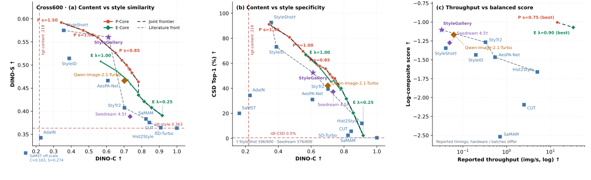
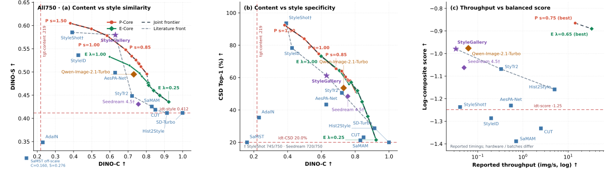

# CLEAVE / WEAVE 整体实验报告

**日期：2026-11-28。** 本报告汇总当前闭集系统、开放域 One-shot、外部基线、独立审计及 RTX 3060 部署结果。依据本地已归档的逐任务评分、原始 JSON 和组件报告；远端运行状态没有在本轮重新查询。未完成项按最后可核验产物列示。本轮只整理报告，不新增训练、推理或裁判评测，Qwen Same150 补推理搁置。

## 1. 当前结论与采用决策

**闭集 CLEAVE Final 已形成从高内容编辑到强风格重绘的有效质量—效率谱；开放域 One-shot 仍有明显差距，当前两条 Reference E-Core 续训路线均不能替换 P+A3。工程端已获得通过全量质量门控的加速，但 Encoder 剪枝及全谱 CFG 蒸馏未达到采用条件。**

| 研究线 | 当前保留方案 | 已验证结果 | 主要边界 |
|---|---|---|---|
| 闭集高内容编辑 | CLEAVE-E，原生 E-Core | λ=.50：C=.8141、S=.4210、Top-1=31.67%；λ=.75：.7204/.4671/45.33% | 生成时不调用 P；强风格能力有限 |
| 闭集重绘 | E→A3→44M P-Core→S10B | s=1：.5502/.5597/69.67%；s=1.5：.3435/.5919/91.17% | 强风格端明显牺牲内容；不是任意参考迁移 |
| 开放域 One-shot | V36 P-Core + Reference-A3 | τ=.50：.6399/.4836/43.83%；τ=.35：.5624/.5047/54.83% | Core-5 对生成器留出；不能扩张为整系统从未见过该画派 |
| Reference E 续训 | 不升级 E0/E1 | E1 等内容 S 下降 .0054–.0065；Top-1 下降 7.66–12.96pp | 仅否定本次配方，不否定所有长训与真实配对 |
| 3060 工程优化 | Optimized；原 A0 TRT FP16 配置 | PyTorch 优化六档通过；A0 TRT 六档通过；E B4 达16.35img/s | 通过预设非劣门，不等于逐像素相同 |
| 压缩/蒸馏 | enc20、全谱 CFG 学生不采用 | enc20：1通过/4拒绝/1不确定；CFG：2/4通过 | enc10 未进正式 test750；新 Full-TRT 组合尚无完整质量结论 |

在 StyleGallery 的 Cross600 内容锚 C=.6113 处，闭集 CLEAVE 插值 Top-1 为 **62.52%（+10.02pp）**，DINO-S 为 **.5394（−.0210）**；正式 One-shot 则为 **47.89%（−4.61pp）**、**.4914（−.0690）**。所以闭集分类优势、开放域差距与 DINO 风格表征差必须分别陈述，不能写成全指标全面超越。

## 2. 系统组成与协议

### 2.1 双核职责与参数

| 组件 | 参数 | 职责 |
|---|---:|---|
| A0 Encoder | 34.16M | RGB→scaled latent，保留编码空间与细节 |
| ConvNeXt 内容编码 | 12.35M | 提取粗语义布局，构造 Stiefel Q32 |
| E-Core | 11.13M | 单步目标画法编辑；高内容独立输出，或提供 P 草稿 |
| A3 | 0 | 对草稿低频亮度/色度作解析统计校准，形成 P 起点 |
| P-Core | 44.54M | 仅以粗布局约束进行条件流重绘，补足强风格能力 |
| S10B | 10.66M | 剪枝解码器，传递编辑 latent 的输出响应 |
| E+P+S10B | 66.33M | 生成与解码参数总和 |
| 完整闭集常驻系统 | 112.84M | 包含公共编码器；不是44M完整系统 |

高内容路径为 `RGB→公共编码器→E→S10B→RGB`；重绘路径为 `RGB→公共编码器→E→A3→P→S10B→RGB`。E/P 为专门化模型，不是每次都要运行两核。One-shot 是另一个系统：45.22M P 主干 + .94M StyleMLP + Reference-A3，不使用闭集 E/K8 作为正式输入。

闭集 P 名义6积分步，首步 midpoint，实测为7次四分支批量调用，即 **28个单条件等价 P 评估 + 1次 E = 29次总 Flow 条件评估**。One-shot 为6次三分支调用、18个条件等价评估。Fast-5 为20个 P 评估，若计入 E 则总数21；这些数字不含 Encoder/Decoder 前向。

组件说明：[E-Core](../e-core/README.md) · [P-Core](../p-core/README.md) · [Conditioning](../conditioning/README.md) · [Decoder](../decoder/README.md)。

### 2.2 正式评测边界

| 项目 | 本报告采用的定义 |
|---|---|
| 冻结任务 | test750 = 150源图×5目标 = Cross600 + Same150 |
| 主读数 | Cross600 跨画派迁移；Same150 单列且不走输出旁路 |
| All750 | 复用同一输出的完整聚合，不是新推理或新训练 |
| 解码 | 本项目默认 S10/S10B；外部方法保留原生 RGB 输出；decoder-only 对照明确例外 |
| 裁判 | 冻结 DINOv2/CSD/CLIP/LPIPS；Zero-DINO 指当前生成/训练不使用 DINO，仍使用 ConvNeXt 预训练特征 |
| DINO-C / S | 内容相似度 / 目标画派库 DINO-S Max；S 不是纯笔触测量，也不等于单参考忠实度 |
| CSD Top-1 | 核心五画派目标识别；不与 Holdout 实例参考 2-way 混用 |
| 统计 | 适用处按150源图聚类配对 bootstrap，2000次、95% CI；插值仅限相邻实测点括区，重采样有效括区次数以原JSON为准 |
| 速度 | 明确硬件、batch、缓存、后端与计时边界；ms/img 的批量吞吐折算不是 B1 延迟 |

test750 曾用于研发与调度选择，不能宣称为从未触碰的盲测集。原 Holdout-750 作品不重叠，但146/150源图、143/150参考图的画家已见；它不同于后续严格源画家隔离 F1，也不同于 One-shot Artist-OOD1000。

## 3. 闭集质量全谱与 Cross600 / All750

### 3.1 现役 E 原生九档、P 十档

以下19个工作点全部来自既有逐任务聚合，每臂750条。P 为最终 E→P 路径，E 为原生路径；同一模型不同旋钮不是新模型。`C/S/T` 分别为 DINO-C / DINO-S / Top-1(%)。

| 路径/旋钮 | Cross C | Cross S | Cross Top-1 | Same Top-1 | All C | All S | All Top-1 |
|---|---:|---:|---:|---:|---:|---:|---:|
| E l025 | 0.9166 | 0.3907 | 2.33% | 98.00% | 0.9238 | 0.4355 | 21.47% |
| E l040 | 0.8560 | 0.4077 | 20.33% | 98.67% | 0.8746 | 0.4493 | 36.00% |
| E l050 | 0.8141 | 0.4210 | 31.67% | 98.67% | 0.8405 | 0.4599 | 45.07% |
| E l055 | 0.7818 | 0.4350 | 40.00% | 99.33% | 0.8134 | 0.4713 | 51.87% |
| E l060 | 0.7780 | 0.4408 | 38.67% | 98.67% | 0.8109 | 0.4759 | 50.67% |
| E l065 | 0.7377 | 0.4583 | 46.33% | 100.00% | 0.7762 | 0.4903 | 57.07% |
| E l075 | 0.7204 | 0.4671 | 45.33% | 98.00% | 0.7633 | 0.4972 | 55.87% |
| E l090 | 0.6579 | 0.4870 | 55.67% | 98.67% | 0.7079 | 0.5139 | 64.27% |
| E l100 | 0.5675 | 0.5077 | 66.83% | 98.67% | 0.5986 | 0.5326 | 73.20% |
| P s060 | 0.7813 | 0.4636 | 38.83% | 99.33% | 0.8034 | 0.4954 | 50.93% |
| P s065 | 0.7443 | 0.4831 | 47.83% | 98.67% | 0.7707 | 0.5114 | 58.00% |
| P s068 | 0.7328 | 0.4903 | 48.33% | 97.33% | 0.7607 | 0.5174 | 58.13% |
| P s070 | 0.7276 | 0.4924 | 49.00% | 97.33% | 0.7561 | 0.5193 | 58.67% |
| P s072 | 0.7133 | 0.5002 | 51.33% | 96.67% | 0.7435 | 0.5255 | 60.40% |
| P s075 | 0.6875 | 0.5101 | 55.67% | 97.33% | 0.7201 | 0.5340 | 64.00% |
| P s085 | 0.6514 | 0.5261 | 57.83% | 96.00% | 0.6870 | 0.5477 | 65.47% |
| P s100 | 0.5502 | 0.5597 | 69.67% | 94.67% | 0.5845 | 0.5780 | 74.67% |
| P s125 | 0.4678 | 0.5749 | 80.83% | 96.67% | 0.4986 | 0.5927 | 84.00% |
| P s150 | 0.3435 | 0.5919 | 91.17% | 97.33% | 0.3822 | 0.6047 | 92.40% |

来源：[聚合 JSON](../performance/protocol_comparison/comparison.json)、[完整 CSV](../performance/protocol_comparison/metrics.csv)，保留逐臂来源与 SHA。研究主表与3060部署复测独立成表，不能用研究 s100 的69.67%替代部署同轮68.50%。

### 3.2 All750 是否更有利

**DINO-C/S 图上 All750 更有利，等内容 Top-1 优势则 Cross600 略大。** 两套图使用相同模型和输出，只改变任务聚合。

| 各自 StyleGallery 内容锚 | Cross600 | All750 |
|---|---:|---:|
| StyleGallery DINO-C | .6113 | .6304 |
| StyleGallery DINO-S | .5604 | .5797 |
| CLEAVE 同内容 DINO-S，插值 | .5394 | .5645 |
| ΔDINO-S | **−.0210** | **−.0153** |
| StyleGallery Top-1 | 52.50% | 61.20% |
| CLEAVE 同内容 Top-1，插值 | 62.52% | 70.60% |
| ΔTop-1 | **+10.02pp** | **+9.40pp** |

完整任务的均值满足 `All750 = .8×Cross600 + .2×Same150`。P s100 Top-1 从69.67%升到74.67%，StyleGallery 同样从52.50%升到61.20%；这不是模型能力增强。All750 的 DINO-S 差距缩小约.0057，但 Top-1 相对优势减小约.62pp。DINO-S 与 Top-1 各自最佳插值可能来自不同旋钮，不拼成一个虚构的联合点；本次未新增匹配内容配对 CI。

主图保留 Cross600，All750 并列作为完整任务补充，避免因聚合更有利而替换研究问题。两图逐面板独立求非支配点，闭集与开放参考设置在图注中区分。





[交互对照](../performance/protocol_comparison/figures/comparison.html) · [完整口径说明](../performance/protocol_comparison/README.md)。速度面板沿用历史计时，不能读作全部方法同硬件、同冷启动条件的加速实验。

## 4. 外部基线与 Qwen 覆盖

### 4.1 D5 冻结任务下的基线

下表前13个方法来自统一 `paper_rgb_v1` 重评聚合快照；Qwen 为独立专项记录。外部公开文献、商业产品、内部历史按方法来源分类，不能用台账 `Published` 标签代替出处。缺失任务保留实际分母。

| 方法 | Cross n | Cross C / S / Top-1 | Same n / Top-1 | All n | All C / S / Top-1 |
|---|---:|---|---|---:|---|
| AdaIN | 600 | 0.2271 / 0.3426 / 34.33% | 150 / 39.33% | 750 | 0.2308 / 0.3484 / 35.33% |
| WCT | 600 | 0.0232 / 0.1542 / 20.00% | 150 / 20.00% | 750 | 0.0232 / 0.1542 / 20.00% |
| CUT | 600 | 0.8435 / 0.3755 / 5.67% | 150 / 92.67% | 750 | 0.8497 / 0.4185 / 23.07% |
| SaMST | 600 | 0.1628 / 0.2738 / 20.00% | 150 / 20.00% | 750 | 0.1601 / 0.2758 / 20.00% |
| SaMAM | 600 | 0.8239 / 0.3832 / 2.50% | 150 / 96.00% | 750 | 0.8307 / 0.4254 / 21.20% |
| SD-Turbo | 600 | 0.9998 / 0.3633 / 0.50% | 150 / 98.00% | 750 | 0.9998 / 0.4116 / 20.00% |
| StyleID | 600 | 0.3885 / 0.5143 / 73.17% | 150 / 98.67% | 750 | 0.4263 / 0.5361 / 78.27% |
| StyleShot | 596 | 0.3569 / 0.5750 / 92.62% | 149 / 97.32% | 745 | 0.3924 / 0.5852 / 93.56% |
| StyTr2 | 600 | 0.7023 / 0.4074 / 39.50% | 150 / 94.67% | 750 | 0.7215 / 0.4482 / 50.53% |
| AesPA | 600 | 0.6075 / 0.4661 / 31.00% | 150 / 92.67% | 750 | 0.6286 / 0.4983 / 43.33% |
| Seedream 4.5 | 576 | 0.7343 / 0.3885 / 37.33% | 144 / 93.06% | 720 | 0.7565 / 0.4306 / 48.47% |
| StyleGallery | 600 | 0.6113 / 0.5604 / 52.50% | 150 / 96.00% | 750 | 0.6304 / 0.5797 / 61.20% |
| Hist2Style | 600 | 0.9083 / 0.3643 / 12.00% | 150 / 95.33% | 750 | 0.9139 / 0.4115 / 28.67% |
| Qwen-Image-2.1-Turbo NF4 | 600 | 0.7016 / 0.4660 / 42.17% | 未完成 | — | 未完成 |

来源：[基线聚合快照](../baseline/evaluation/paper_rgb_v1_aggregates.json)、[基线说明](../baseline/README.md)、[Qwen 专项 JSON](../archive/historical/v28/qwen_turbo_cross600_summary.json)。这些读数是本仓库重评结果，不能替代各论文原测试集成绩。

WCT/SaMST 等低内容或接近单类输出的读数只代表现存实现与输出，尚不构成对方法理论能力的否定。StyleShot 缺5任务、Seedream 缺30任务；现有均值前沿仅支持有效样本上的二维比较，不能升级为完整同任务显著支配。公开文献前沿不包含商业 Seedream；SD-Turbo 作参照点。

### 4.2 Qwen 的600与750

Qwen-Image-2.1-Turbo 专项归档明确为 **600个 Cross 任务**：512px、8步、text encoder 与 transformer 的4-bit NF4量化、CPU offload。C=.7016、S=.4660、Top-1=42.17%、CLIP-S=.6975、Affinity=.5817、LPIPS=.6256；3060 记录均值16.071s/img（599个有效计时样本），峰值显存7322.5MB。

**当前报告没有可采用的 Qwen Same150/All750 完整结果。** 因而 Qwen 只进入 Cross600 数表，不填造 All750；补推理与环境排查已搁置，也不凭此前启动信息宣称补全成功。另一个“600条”是 F2 的8方法×75个 VLM 单图评分，与 Qwen 图像生成600图不是同一件事。

## 5. 闭集系统的独立贡献与限制

### 5.1 条件过滤：Stiefel 保布局、删除二阶相关

| 同类表征探针 | Gram五分类 | Spatial五分类 |
|---|---:|---:|
| PCA-32 | 95.00% | 82.00% |
| 对角白化 | 95.67% | 81.33% |
| Stiefel Q32 | **20.67%** | **76.33%** |

同构44M、相同训练预算的双种子对照，相对白化 s100 Top-1 **+4.83/+6.67pp**，S **+.0153/+.0159**。但等 C=.50/.61/.70 的 S 增益为 **+.0048/+.0033/−.0003**，高内容端收益很小。Gram 接近随机不等于空间/高阶风格信息全部独立；语义全置零或打乱会损伤内容，因此目标是选择性过滤。

### 5.2 E 草稿与 A3：解除源锁定

固定44M P、噪声和调度，在 s100 只换草稿：原源 latent Top-1=10.17%、色度匹配17.17%、E66.17%、E+A3 69.00%。相对色度匹配，E +49.00pp，95% CI[45.50,52.33]pp。正误目标四象限如下：

| E+A3目标 | P正确 | P错误 |
|---|---:|---:|
| 正确 | 69.00% | 53.00% |
| 错误 | 3.67% | 2.17% |

固定 P 正确时纠正草稿 +65.33pp；固定正确草稿时纠正 P +16pp。二者为不同简单效应，不能相加。A3 对同权重 s100 另有 S +.0086、CI[.0066,.0104]，Top-1 +2.83pp。上述固定旋钮实验也改变了内容工作点，不冒充等内容增益。

### 5.3 P 容量与双核分工

22.29M→44.54M 同配方扩容，s150 Top-1 从76.00%升至91.17%；扩容支持目标重绘，但32×32结构注入、更细源控制没有相应推动等内容前沿。3500→7000步的本次续训反而使 s100 Top-1 从69%降至64%，保留3500 EMA；该续训重启了优化器，不是所有自然训练轨迹的收敛证明。

同规模 Unified58M 与 E+P 对照：C=.50时 S/Top-1 为 **.5612/55.63% vs .5690/76.47%**；s150 为74.67% vs91.17%。这支持当前专门化方案，但训练监督不同，不能宣布所有共享多任务主干都失败。

困难画派仍依赖较强编辑：P s085 ER/Uki 为25.8%/26.7%，低于 Imp/Min 的93.3%/92.5%；s150 ER/Uki 提高到90.8%/79.2%，同时整体 C 降到.3435。不是在高保真条件下已经解决所有困难画派。

### 5.4 S10B：固定 latent 的解码贡献

| 固定 P8 latent（P9b） | 原版 Decoder Top-1 | WikiArt FT | S10B | S10B−原版，95% CI |
|---|---:|---:|---:|---|
| E+A3 l090 | 48.17% | 50.67% | 57.33% | +9.17pp [6.50,11.83] |
| P s085 | 50.50% | 53.67% | 57.83% | +7.33pp [4.67,10.17] |
| P s100 | 58.00% | 63.50% | 70.17% | +12.17pp [9.33,15.17] |
| P s150 | 82.83% | 80.33% | 91.17% | +8.33pp [6.00,10.83] |

S10B 参数较49.49M原版减少78.5%，P2解码记录提速3.43×。它与旧 S10 是同权重独立包装，训练为结构剪枝+L1/LPIPS恢复，不是 C1 响应蒸馏。P9b s100 的70.17%保留为独立 decoder 对照，不覆盖主表69.67%。部分点 C 略降；生成器也可能适配 S10，因此不能说解码压缩普遍改善所有质量，或把频谱观察写成完整通道因果机制。

## 6. 从原计划到当前主线：哪些假设被实验修正

原综述提出先诊断参考响应、局部路由和时间预算，再测试真实画作终点。该计划在历史 Stage 1 上已执行，不能将这些旧权重结果冒充当前 CLEAVE Final。

| 历史四步/S10对照 | Cross Top-1 | C | S | ER+Uki命中 | 结论 |
|---|---:|---:|---:|---:|---|
| Stage 1 全局 Euler | 53.17% | .5665 | .5395 | 13/240 | 无旁路 Same150 仅65.33%，旧96.67%来自旁路 |
| 拟合四步时间网格 | 52.50% | .5657 | .5396 | 13/240 | −.67pp，CI[−1.50,0]pp，未获免费增益 |
| Q32 调起点 | 55.17% | .5462 | .5468 | 14/240 | Top-1提高伴随内容损失 |
| 起点+局部时钟 | 54.83% | .5498 | .5453 | 13/240 | 未超单改起点 |
| 350步旧教师终点 | 36.67% | .3704 | .5564 | 15/240 | 纯噪起点三臂先导 |
| 同画作真实对齐 | 49.00% | .3609 | .5694 | 2/240 | 总体分类涨，但未突破ER/Uki |
| 同类真实乱配 | 50.67% | .3287 | .5839 | 0/240 | 总体涨幅不证明个体配对有效 |

对齐相对教师的 ER/Uki −5.42pp，CI[−8.54,−2.50]pp；对齐相对乱配 C +.0321、LPIPS −.0502，说明配对有代理域恢复收益，但不能据此扩写成目标画法收益。纯噪起点本身使冻结模型 C=.5665→.1953，是这轮先导的重大混杂；其结果只约束该实现，不能否定全部真实终点路线。后续 sharp-bridge 修正配置的启动记录不等于已完成验收。

Partial-FGW 在受控翻转、同80.08%覆盖率下，将精确patch命中30.08%→53.69%、纹理MAE .00567→.00238；这支持几何约束匹配，不证明跨画作部件注入有效。Part-Bank 新方案没有因这份计划自动成为生产组成。Stage 2a 历史评测 ER/Uki 已到77/120、61/120，Same无旁路82.67%；此后系统又经历草稿路由、Zero-DINO、A3和容量控制等迭代，最终以第3节当前模型为准。

来源：[原综述复核及原始数据索引](../archive/historical/exp1123/04_SURVEY_FOLLOWUP.md)。历史失败路线与当前贡献串联的是**监督映射是否一致、是否解除源锁定、相同内容下是否改善目标画法**，不能简化成持续堆模块必然提升。

## 7. One-shot：正式基线、续训结果和泛化

### 7.1 V36 正式方案

Seen-Train 76,319张、131可见画派；Core-5 从生成器训练及 PCA/Stiefel/归一化拟合中排除。固定公共编码器/解码器可能有更广预训练经历，因此只声明对应训练与条件拟合的留出边界。

| P+Reference-A3 | C | S | Top-1 | Margin | CLIP-S | Affinity | LPIPS | Same150 | 错参考Top-1 |
|---|---:|---:|---:|---:|---:|---:|---:|---:|---:|
| τ=.00 | .5166 | .5016 | 56.17% | +.0274 | .7167 | .6092 | .6569 | 82.67% | 4.17% |
| τ=.35 | .5624 | .5047 | 54.83% | +.0267 | .7196 | .6122 | .6323 | 86.67% | 4.17% |
| τ=.50 | .6399 | .4836 | 43.83% | −.0306 | .7087 | .5962 | .5756 | 90.00% | 4.33% |
| τ=.65 | .7535 | .4541 | 26.33% | −.1082 | .6896 | .5719 | .5072 | 93.33% | 3.83% |
| τ=.80 | .8492 | .4156 | 14.17% | −.1914 | .6698 | .5427 | .4470 | 96.00% | 2.50% |

τ=.50 起点消融 I0/I1/I2 的 Top-1 为14.33/24.33/43.83%，C为.7087/.6707/.6399；Full Reference-A3 的收益伴随编辑增强。等 StyleGallery 内容 C=.6113，One-shot 插值 S=.4914、Top-1=47.89%、LPIPS=.5965；StyleGallery 为.5604/52.50%/.5576。不能用 τ=.35 的54.83%单独宣称超越 StyleGallery，因为 C 低.0489。

### 7.2 V37 E0/E1：同曝光续训没有形成替代方案

固定12小时预算上限，实际约6小时24分、11月28日04:46收工。E0/E1 均从4500续至12902步，各新增8402次更新；正式14臂各750条、独立Holdout24臂已完成。P4未过预定门槛而跳过，不能写成额外P训练已完成。

| V37臂（完整14×750） | C | S | Top-1 | LPIPS | Same150 Top-1 |
|---|---:|---:|---:|---:|---:|
| V37_E0_E_l60 | 0.7222 | 0.4214 | 29.83% | 0.5101 | 92.00% |
| V37_E0_E_l80 | 0.6200 | 0.4485 | 38.33% | 0.6271 | 86.00% |
| V37_E0_E_l100 | 0.5756 | 0.4649 | 39.33% | 0.6719 | 80.67% |
| V37_E0_EP_t35 | 0.4688 | 0.5309 | 61.17% | 0.7212 | 76.00% |
| V37_E0_EP_t50 | 0.4823 | 0.5292 | 56.33% | 0.7172 | 76.00% |
| V37_E0_EP_t65 | 0.5224 | 0.5219 | 49.33% | 0.7016 | 77.33% |
| V37_E0_EP_t80 | 0.5645 | 0.5007 | 41.83% | 0.6831 | 80.00% |
| V37_E1_E_l60 | 0.9163 | 0.3802 | 2.50% | 0.2648 | 96.00% |
| V37_E1_E_l80 | 0.9077 | 0.3805 | 2.33% | 0.2863 | 96.00% |
| V37_E1_E_l100 | 0.8990 | 0.3829 | 3.67% | 0.2986 | 96.67% |
| V37_E1_EP_t35 | 0.5833 | 0.4923 | 41.33% | 0.5167 | 86.67% |
| V37_E1_EP_t50 | 0.6433 | 0.4769 | 30.00% | 0.4643 | 86.67% |
| V37_E1_EP_t65 | 0.7433 | 0.4517 | 19.83% | 0.4011 | 88.67% |
| V37_E1_EP_t80 | 0.8480 | 0.4134 | 10.00% | 0.3387 | 94.67% |

| E1+P 相对 P+A3，等内容 | ΔS | 源图聚类95% CI | ΔTop-1 |
|---|---:|---|---:|
| C=.60 | −.0065 | [−.0115,−.0012] | −11.32pp |
| C=.65 | −.0058 | [−.0106,−.0005] | −12.96pp |
| C=.70 | −.0054 | [−.0094,−.0010] | −10.34pp |
| C=.75 | −.0057 | [−.0103,−.0008] | −7.66pp |

E0+P 仅覆盖 C=.4688–.5645，不外推到预定 .60–.75；事后低内容 C=.53 的 ΔS=+.0155、CI[+.0006,+.0262]，同时 Top-1 −7.80pp，是局部指标取舍。E1 独立 λ=1 的 C=.8990、Top-1=3.67%，表现为强保源。

12批局部梯度审计 A/B/C 平均投影为81.14%/18.21%/.65%；A任务将代理latent与目标原画Q32组合，存在条件捷径。E1 同时改变 B 的监督目标、样本来源和 Q32，尚未正交隔离教师强度、捷径和损失权重。结果与“教成保守修复”一致，不能把全部失败归因某一模块，更不能认定优化器或小模型存在固有上限。

来源：[V36报告](../one-shot/V36_CLEAVE_ONE_REPORT.md)、[V37完整结果](../one-shot/V37_RESULTS.md)、[V37等内容CI](../../runs/v37_editing/matched_content_ci.json)、[修正后的阶段结论](paper-audit/POST_12H_CONCLUSIONS.md)。

### 7.3 独立泛化与参考响应

| 数据/实验 | 实测 | 支持的结论 |
|---|---|---|
| Artist-OOD1000，等C=.70 | E0 ΔS=−.0227，CI[−.0344,−.0176]；Δ2-way=−3.02pp | E0的高固定档跟随率不等于等内容优势 |
| Artist-OOD1000，等C=.75 | E1 ΔS=−.0075，CI[−.0098,−.0053]；Δ2-way=−10.32pp | E1未改进正式方案 |
| Movement-OOD500，等C=.70/.75 | E1 ΔS=−.0117/−.0120，CI均负 | 留出目标画派上也不支持升级 |
| One-shot τ=.50，A3/P参考四象限 | 均正确43.83%；仅A3正确19.00%；仅P正确16.17%；均错4.33% | 解析起点与神经参考都有效 |
| F3参考交换 | 200组三元组，τ=.50/.35遵循率87.5%/92% | 有实例条件响应 |
| F3同色盘控制 | 全流程64组65.62%；固定A3另一设置78.12% | 色盘之外仍有信号；两种设置不混算 |
| F3内容交换 | 100对，遵循率99% | 内容条件确实被使用 |

实例二选一跟随不是五画派目标分类，也不能独自证明正确重绘笔触。更强的闭集E草稿给冻结 One-shot P，在τ=.75获得 C=.6117/S=.5179/Top-1=64.50%，说明草稿值得研究；该E见过Core-5，只是诊断起点，不是正式One-shot或数学上界。

## 8. 冻结后的独立审计

### 8.1 F1 未见源画家

另建 Artist-Holdout-750：150源图、38源画家，与训练集、原test750及参考画家零重叠；所有750任务都是跨画派，不能当原 Cross600。

| 方法 | C | S | Top-1 |
|---|---:|---:|---:|
| 闭集 E λ=.75 | .7945 | .5031 | 54.93% |
| 闭集 E→P s=.85 | .7069 | .5563 | 63.07% |
| 闭集 E→P s=1 | .5971 | .5941 | 72.40% |
| One-shot τ=.50 | .5186 | .5334 | 56.27% |
| One-shot τ=.65 | .7256 | .5051 | 42.13% |

One-shot τ=.50相对错参考 Top-1净增44.80pp、CI[40.80,48.80]；闭集s100相对错目标+61.20pp、CI[56.80,65.47]。支持该集合上的控制泛化，不能将两套数据均值的差写成提升。原汇总 `delta_s_vs_v32` 跨数据集字段不作增益证据；`bracketed=false`不使用。

### 8.2 F2 独立 VLM

Qwen3.8-27B量化VLM，600条单图评分（8方法×75，1–5分）。这不是Qwen图像生成基线，也不是人评。

| 方法 | 内容 | 参考画法 | 艺术重绘 | 干净度 |
|---|---:|---:|---:|---:|
| 闭集 s085 | 4.547 | 2.413 | 3.107 | 3.893 |
| 闭集 s100 | 4.013 | 2.453 | 3.187 | 3.787 |
| One-shot τ=.50 | 2.920 | 2.467 | 2.640 | 3.227 |
| StyleGallery | 4.067 | 2.440 | 2.773 | 3.360 |
| Seedream | 4.680 | 1.947 | 2.493 | 4.333 |

One-shot 内容落后StyleGallery 1.147分，画法差+.027不作优势结论。成对只有213条有效判决，未完成40题×6对×双位置480条；s085对StyleGallery为20:15、有效35，不能宣布显著胜出。布局泄漏轴接近饱和，不据此证明无泄漏。

### 8.3 未完成项与无效指标

| 项目 | 目前可核验状态 | 本报告处理 |
|---|---|---|
| F4 编解码容量非对称机制 | 原执行失败，未见完整验收汇总 | 使用已有受控decoder结果，收窄机制主张 |
| F5 E/P交界连续性 | 用户取消；既有交界RMSE=.1935高于内部.033–.088 | 不称视觉平滑，不追加任务 |
| F6照片泛化 | 30照片×5目标=150/臂；另Part B为120/臂，Seedream118/120 | 仅为子集；非完整P2A-256 |
| F1/F6 LPIPS | source uint8直接作为reference，违反RGB01输入契约 | **LPIPS及对应CI暂停引用，待修正重算** |
| F7新组合TRT | 本地有16份测速；18:33有恢复队列快照，未见summary | 速度候选单列；不宣称当前存活或质量通过 |

F1/F6的DINO/CSD/CLIP采用另一条特征路径，不因LPIPS错误被直接否定；错误也不自动扩张到 V37正式CI或3060验收。One-shot照片子集τ=.50为 C=.2431/S=.5091/Top-1=59.33%，明显内容代价，不称照片泛化成熟。原始审计入口：[阶段总结](paper-audit/POST_12H_CONCLUSIONS.md)、[F1](../../runs/paper_audit/f1_summary.json)、[F2](../../runs/paper_audit/f2_summary.json)、[F3](../../runs/paper_audit/f3_summary.json)。

## 9. RTX 3060 部署：通过的加速与拒绝的候选

### 9.1 纯 PyTorch 优化

同轮 RTX3060、host RGB→host RGB，含H2D/D2H、不含文件I/O；模型暖机常驻，不是进程冷启动。

| 路径 | Batch | Reference ms/img | Optimized ms/img | 吞吐 | 加速 |
|---|---:|---:|---:|---:|---:|
| E-only | 1 | 144.91 | 111.80 | 8.94img/s | 1.30× |
| E-only | 2 | 150.87 | 81.21 | 12.31img/s | 1.86× |
| E-only | 4 | 144.41 | 83.08 | 12.04img/s | 1.74× |
| E→P | 1 | 372.73 | 221.36 | 4.52img/s | 1.68× |
| E→P | 2 | 346.90 | 182.92 | 5.47img/s | 1.90× |
| E→P | 4 | 322.10 | 181.98 | 5.49img/s | 1.77× |
| Fast-5 E→P | 4 | 322.10 | 153.55 | 6.51img/s | 2.10× |

16臂×750正式评测中，Optimized六档通过预设非劣门。门槛为候选相对控制的95% CI：ΔC/ΔS下界≥−.005，ΔTop-1/ΔSame150下界≥−2pp，ΔLPIPS上界≤+.005；兼容蒸馏使用相同阈值。Opt |ΔC|≤.0004、ΔTop-1=−.50至+.83pp。**后续S0严格复核更正：Fast-5仅三档通过，s100的Same150下降1.33pp，CI[−4,+1.33]pp，严格判为inconclusive；旧汇总的四档PASS不能继续引用。** s150 S下降.0023仍处门内。通过不是完全相同。见[第一阶段计划](optimization/training/STAGE1_PLAN.md)。

同轮B4阶段耗时：A0 66.03→48.01ms，结构条件6.27→1.83ms，E+A3 6.79→1.54ms，P轨迹178.67→99.60ms，S10 68.68→32.10ms。Hot-Cached的E/P B4为29.74/7.48img/s，单列为缓存上限，不能混为完整RGB吞吐。

compile首次捕获约E50.2s/P63.0s，另有模型加载；短命CLI可用Optimized-Eager，约5.5s启动，E/P约123.1/305.4ms。B1独立进程nvidia-smi为E1161MiB/P1423MiB；更大batch存在CUDAGraph池保留，不用allocated数值冒充总显存。来源：[Profile与完整质量报告](optimization/RESULTS.md)。

### 9.2 A0 TRT 与兼容蒸馏

下面是另一轮同口径控制，不与上一表拼接计算加速比。

| 配置 | E B1 / B4 ms/img | P B1 / B4 ms/img | 质量门控 | 决策 |
|---|---:|---:|---|---|
| 同轮 Optimized | 112.56 / 83.30 | 223.18 / 184.53 | 控制 | 保留 |
| 原A0 TRT FP16，S10仍PyTorch | **67.25 / 61.15** | **177.40 / 160.87** | **6/6通过** | 质量可采用；P B4加速1.147×未到该轮15%速度线 |
| enc20剪枝蒸馏 | 77.40 / 74.71 | 186.86 / 175.44 | 1通过、4拒绝、1不确定 | 不作全谱替换 |
| 单分支CFG学生 | — | 158.65 / 116.67 | 2/4通过 | 不作全谱替换 |

A0 TRT 的 E B4为16.35img/s，较同轮1.362×；P为6.22img/s。enc20 19.230M、训练5297步，128图校准MAE255=2.682；enc10 11.264M、6000步、MAE255=3.222，后者未进test750。校准更好不保证下游质量，enc20高内容区 C下降.0064–.0092、LPIPS增加.0044–.0108，整体不采用。

CFG学生12000步，P条件评估28→7（加E总8），B4达8.57img/s、1.582×；但s100/s150 Top-1下降3.17/7.83pp，Same150下降2.67pp。不能以速度覆盖强风格损伤。上述最终判定以[原始验收JSON](../performance/data/3060_distillation_summary.json)及[阶段纠错](paper-audit/POST_12H_CONCLUSIONS.md)为准，历史文字“enc20 5/6明确拒绝”不再采用。

### 9.3 新F7测速只作候选

| 同一新F7 B4测试 | E ms/img | P ms/img | 完整质量 |
|---|---:|---:|---|
| Optimized控制 | 86.374 | 199.886 | 同轮速度基准 |
| S10 TRT | 78.580 | 182.692 | 待验收 |
| A0+S10 TRT | 63.314 | 169.037 | 待验收 |
| Full TRT | 65.165 | 143.012 | 待验收 |

更多TRT组件未必使E路径更快。16份本地B1/B4测速包含初始化、首次执行、稳态拆分，但没有最终质量summary；18:33启动快照只能说明当时恢复，报告不据其推测当前在跑或全部完成。[测速记录](../../runs/paper_audit/f7_3060/speed/) · [归档状态快照](../../runs/paper_audit/f7_3060_status.json)。

## 10. 最终可写的主张与交付边界

| 可由当前证据支持 | 仍不能由当前证据支持 |
|---|---|
| 专门化E/P形成闭集质量—效率谱，E高内容独立运行 | 44M就是整个系统，或所有请求执行两核 |
| 二阶过滤、草稿路由、解析起点及解码响应各有受控证据 | 所有收益可相加，或已实现完全内容/画法独立 |
| 闭集在等内容处目标分类领先StyleGallery | 对其DINO风格、所有画派和所有指标全面支配 |
| One-shot对参考有响应，但等内容风格仍有差距 | 高2-way跟随率证明笔触正确，或轻量体系存在不可突破上限 |
| 两条具体续训配方未达采用标准 | 所有更长训练、所有反向真实配对都无效 |
| 3060纯PyTorch与A0 TRT有全量门控后的收益 | 这些结果是严格零误差，或全部TRT组合已验收 |

当前维持闭集 Final、One-shot P+A3与已验收部署配置。Qwen补推理不作为报告完成条件；F5取消；F4/F2补齐、新F7质量与F1/F6 LPIPS修正仍属于未完成证据，不用预计值填表。本报告不启动这些任务。

从零复现还需补齐部分 V29/V32 执行源码与节点配置；权重/配置保管见[资产清理](../../cleanup.md)。当前报告是**已有产物的整体汇总**，不代表新论文PDF、所有LaTeX宏或远端部署均已同步完成。

## 11. 证据索引与轻量复核

| 证据 | 用途 |
|---|---|
| [P8原始报告](../archive/historical/v35/data/p8_final_report.json) / [P9](../archive/historical/v35/data/p9_paper_audit_report.json) | 最终闭集、同latent解码、双核/单核对照 |
| [聚合快照](../performance/protocol_comparison/comparison.json) / [基线聚合](../baseline/evaluation/paper_rgb_v1_aggregates.json) | 19个现役点及13方法、Cross/Same/All实际分母 |
| [Qwen600原始评测](../../runs/v28_qwen_turbo_cross600/eval.json) | 独立生成基线；无Same150补全结论 |
| [V37正式结果](../../runs/v37_editing/official_core750.json) / [Holdout](../../runs/v37_editing/holdouts/summary.json) | 14臂test750、24臂独立Holdout |
| [V37完成标记](../../runs/v37_editing/completion.json) / [P4决策](../../runs/v37_editing/p4_decision.json) | 实际时长与按门槛停止 |
| [3060优化](../performance/data/3060_profile_summary.json) / [兼容蒸馏](../performance/data/3060_distillation_summary.json) | 同轮速度、质量门、最终采用状态 |
| [审计纠错总结](paper-audit/POST_12H_CONCLUSIONS.md) | 无效LPIPS、缺失判决、未完成阶段的引用边界 |

两种聚合的矢量图可由已有快照复现，无需GPU：

```powershell
python docs/performance/plot_cleave_pareto.py --compare-aggregation
```

本轮轻量复核已通过：19个现役臂共14,250条记录逐臂task_id唯一，Cross/Same/All聚合与缓存逐任务重算一致；Qwen原评分为600 Cross、0 Same；14个V37臂均600 Cross+150 Same；本报告及3个导航文件的相对链接均存在。未重复运行模型评测，未将历史运行状态写成实时状态。
